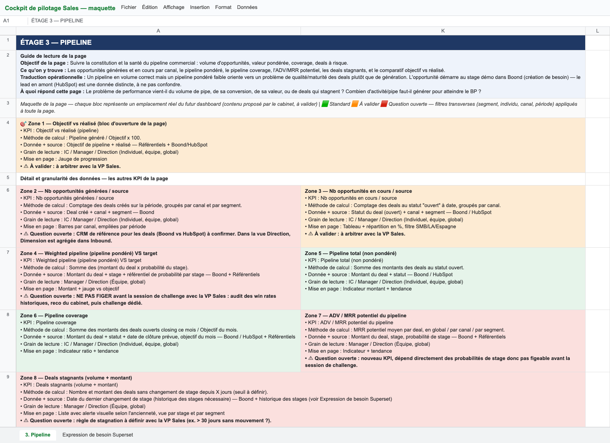

# Cas pratique : Senior Analytics Engineer

Bienvenue et merci de prendre le temps de te pencher sur ce cas pratique. On sait que ça représente un vrai investissement de ta part et on a hâte de voir ce que tu en feras.

Le sujet ressemble beaucoup à ce qu'on vit au quotidien dans l'équipe data : un besoin métier, des données imparfaites et pas mal de discussions.

Dans ce dépôt tu trouveras de quoi t'y mettre : une base ClickHouse chargée de données, un projet dbt vide qui s'y connecte, la documentation des tables et l'expression de besoin d'une équipe métier.

**En bref**

- **Rendu** : 3 jours après l'accès au dépôt, à la même heure (par exemple lundi 10 h → jeudi 10 h).
- **Restitution** : 1 h 30 en visio avec des personnes de l'équipe data.

> **Avant de commencer**
>
> Ce cas est à la fois détaillé et flou. C'est voulu, promis : c'est souvent comme ça qu'un sujet arrive chez nous.
>
> Il n'y a ni minimum ni maximum de choses à accomplir et on ne note pas le temps passé. Que tu aies 10 heures ou tout un week-end devant toi, on regarde la même chose : tes choix, la façon dont tu les expliques et la qualité de ce que tu livres. Ce que tu n'as pas eu le temps de faire, on en parlera ensemble à la restitution.
>
> Un livrable concret nous donnera toujours plus confiance qu'une intention décrite à l'oral. Mieux vaut peu de choses abouties et bien expliquées que beaucoup de choses inachevées.
>
> C'est aussi la première version de ce cas pratique et il a sûrement encore quelques angles morts. S'il y a une erreur, quelque chose qui te paraît bizarre, une information qui manque ou quoi que ce soit d'autre, n'hésite pas à [nous contacter](#contact) : ça nous aide aussi à l'améliorer.

---

## 1. Le contexte

Boond édite un ERP/CRM SaaS pour les ESN et les sociétés de conseil.

Notre modèle d'acquisition est celui d'un SaaS B2B classique. Un prospect remplit un formulaire sur notre site ou sur LinkedIn et devient un contact dans HubSpot, qu'une automatisation recopie dans Boond. Un commercial le contacte, le qualifie, et un besoin est ouvert dans Boond. S'il est intéressé le prospect assiste à une démo puis reçoit une proposition. Un deal signé devient un abonnement mensuel. Le détail étape par étape avec les tables où chaque information atterrit est dans [`docs/cycle-de-vie.html`](docs/cycle-de-vie.html).

Notre équipe sales (trois équipes : SMB, Large Accounts, Espagne) utilise notre propre produit comme CRM : sociétés, contacts, besoins (les opportunités commerciales, que les équipes appellent aussi deals) et actions (appels, démos, rendez-vous). Le marketing travaille dans HubSpot : les formulaires y arrivent et les besoins ouverts dans Boond y sont recopiés en retour, dans le pipeline de deals. Les abonnements de nos clients sont aussi gérés dans Boond sous forme de projets et de livraisons.

Côté data les données de Boond arrivent dans ClickHouse par un flux en temps réel. Les tables `raw` gardent toutes les versions de chaque enregistrement. On transforme avec dbt et on restitue avec Superset (même si dans le cadre de cet exercice on ne l'utilisera pas).

## 2. Le sujet

La VP Sales a travaillé avec un cabinet externe sur un cockpit de pilotage commercial. Pour le pipeline le résultat est une maquette dans un tableur. C'est une *proposition* : on te la transmet avec carte blanche pour jouer ton rôle de Senior Analytics Engineer et proposer un dashboard qui ira probablement au-delà, sur le fond comme sur la forme.

Tu trouveras dans le dépôt :

- la page Pipeline du tableur : [`docs/besoin/maquette-pipeline.png`](docs/besoin/maquette-pipeline.png) ;
- la page « Expression de besoin Superset » du même tableur : [`docs/besoin/expression-de-besoin.md`](docs/besoin/expression-de-besoin.md).



Personne de l'équipe data n'a encore échangé avec l'équipe sales sur ce document : tu le découvres en même temps que nous. Ta réponse sera donc le premier retour de l'équipe data à la VP Sales.

Tu verras que la maquette et [`docs/cycle-de-vie.html`](docs/cycle-de-vie.html) ne situent pas l'ouverture du besoin au même moment. Ce n'est pas une coquille : c'est une vraie question chez nous.

En creusant tu entendras aussi :

> Un responsable d'équipe sales : « Le MRR, c'est le montant signé sur le deal dans Boond. »
>
> Le marketing : « Notre MRR, c'est le montant du deal dans HubSpot. »
>
> Un commercial : « Une démo, c'est quand le deal passe en Show Boond. »
>
> Un autre commercial : « Les démos, on les compte dans l'agenda : Démo 1, Démo complémentaire. »

Il y a des écarts entre ce que le métier exprime et ce que la donnée permet. L'idée est de construire la meilleure réponse possible avec ce qui existe, de dire clairement ce qui manque et de proposer des pistes.

Pendant ces trois jours tu n'auras pas de réponse du métier : pose tes hypothèses, note tes questions, on y répondra à la restitution.

## 3. Ce qu'on te demande

1. **Communiquer et t'organiser.** Avec la maquette, la VP Sales t'a posé une seule question : « Je l'ai quand ? ». L'équipe sales compte sur toi pour l'accompagner du début à la fin : ce qui est faisable, dans quel ordre, pour quand, et ce dont tu as besoin de sa part. Chez nous tout passe par Slack et tout le monde y est joignable : la VP Sales, les responsables d'équipe, les commerciaux, le marketing et la finance.

   Écris dans un document les messages que tu enverrais au fil de ton travail (à qui, où, quand, pourquoi) et montre comment tu organiserais le sujet jusqu'à la livraison pour ne rien laisser tomber.
2. **Dessiner le dashboard.** Propose la maquette du dashboard Pipeline : ses onglets, ses filtres et pour chaque graphique ce qu'il montre, sous quelle forme et à quelle question il répond. L'outil est libre.
3. **Modéliser.** Dans `dbt/` construis les modèles qui alimentent la V1 de ton dashboard. À toi de choisir ce qu'elle couvre et de dire pourquoi.
4. **La requête actuelle.** L'équipe sales sort aujourd'hui ses chiffres de pipe avec [`legacy/pipeline_actuel.sql`](legacy/pipeline_actuel.sql). Elle passe sur ce jeu de données mais rame sur de gros volumes, et plus personne ne sait vraiment ce qu'elle calcule. À toi de voir ce que tu en fais.

Fais comme si tu étais déjà dans l'équipe : livre ton travail comme tu le livrerais en production chez nous. Tout ce qui améliore la qualité de ton travail ou du dépôt est bienvenu.

## 4. L'IA

> **On pilote l'IA. Elle ne nous pilote pas.**
>
> On travaille tous les jours avec des agents IA et tu peux bien sûr en faire autant, avec l'outil de ton choix. Chez nous l'IA propose et on décide : on relit, on vérifie et on assume ce qui sort. À la restitution, c'est le raisonnement derrière chaque modèle, chaque chiffre et chaque message qui nous intéressera le plus.

Garde une trace de tes sessions, peu importe la forme : tes prompts, les fichiers d'instructions de ton agent, ses réponses. Elle fait partie du rendu ;)

## 5. Démarrer

Prérequis : Docker, Git et [uv](https://docs.astral.sh/uv/).

```bash
docker compose up -d --wait   # ClickHouse ; les données sont chargées au premier démarrage
cd dbt
uv run dbt debug              # crée l'environnement Python et vérifie la connexion à ClickHouse
```

- ClickHouse : `localhost:8123` (HTTP et éditeur SQL sur `/play`) ou `localhost:9000` (natif). Utilisateur `default` sans mot de passe.
- Client en ligne de commande : `docker compose exec clickhouse clickhouse-client`.
- Pour repartir de zéro : `docker compose down -v` puis `docker compose up -d --wait`.
- Sans uv : un venv en Python 3.11 à 3.13 (dbt ne tourne pas encore sous 3.14) et `pip install dbt-core==1.11.12 dbt-clickhouse==1.10.1`.

Si quelque chose coince à l'installation, [écris-nous](#contact) sans attendre : on préfère que tu passes ton temps sur le sujet.

## 6. Les données

Ouvre [`docs/model/index.html`](docs/model/index.html) dans ton navigateur pour voir le modèle. Chaque table est une carte et chaque ligne de la carte une colonne de la table. Les liens montrent comment les tables se rejoignent. Clique sur une colonne pour savoir d'où elle vient et à quoi elle sert. Le même contenu est en JSON dans [`docs/model/model.json`](docs/model/model.json), pratique pour ton agent IA.

| Table | Contenu |
|---|---|
| [`raw.opportunities`](docs/model/index.html#raw.opportunities) | Besoins commerciaux : étape, montant, dates, origine, responsable, société |
| [`raw.actions`](docs/model/index.html#raw.actions) | Actions du CRM : appels, démos, rendez-vous |
| [`raw.companies`](docs/model/index.html#raw.companies) | Sociétés : pays, effectif, pôle |
| [`raw.contacts`](docs/model/index.html#raw.contacts) | Contacts rattachés à une société |
| [`raw.ressources`](docs/model/index.html#raw.ressources) | Collaborateurs dont les commerciaux |
| [`raw.businessunits`](docs/model/index.html#raw.businessunits) | Équipes commerciales et leurs membres |
| [`raw.agencies`](docs/model/index.html#raw.agencies) | Agences : France et Espagne |
| [`raw.poles`](docs/model/index.html#raw.poles) | Pôles qui segmentent les sociétés |
| [`raw.dictionaries`](docs/model/index.html#raw.dictionaries) | Référentiels : étapes des besoins, types d'action, origines |
| [`raw.projects`](docs/model/index.html#raw.projects) | Projets clients rattachés au besoin signé |
| [`raw.deliveries`](docs/model/index.html#raw.deliveries) | Lignes d'abonnement d'un projet : montant mensuel, période |
| [`hubspot.contacts`](docs/model/index.html#hubspot.contacts), [`hubspot.deals`](docs/model/index.html#hubspot.deals) | Contacts et deals vus du marketing |
| [`ref.sales_targets`](docs/model/index.html#ref.sales_targets) | Objectifs mensuels tirés du tableur de la VP Sales |
| [`ref.stage_probabilities`](docs/model/index.html#ref.stage_probabilities) | Probabilité de signature par étape proposée par le cabinet |

Conventions des tables `raw` :

- une ligne = une version d'un enregistrement datée par `meta.ts` ;
- `meta.deleted` marque une suppression ;
- `relationships.<lien>.data.id` porte l'identifiant de l'enregistrement lié (`relationships.company.data.id` → `raw.companies.id`).

## 7. Rendu

- **Ton dépôt** : pousse-le sur un dépôt privé (GitHub, GitLab ou Bitbucket) et donne-nous l'accès (nos adresses sont [en bas de page](#contact)). Tu peux aussi nous envoyer un bundle (`git bundle create rendu.bundle --all`). Préviens-nous par mail quand c'est en ligne.
- **Dans le dépôt, au format de ton choix** : ta maquette de dashboard, ton document de communication et d'organisation et la trace de tes sessions IA.

## 8. Restitution

1 h 30 : 30 à 40 min pour présenter ton travail, puis on en discute avec des personnes de l'équipe data, comme on le ferait entre collègues. Tu peux faire des slides mais rien d'obligatoire :)

<a id="contact"></a>

## Une question ?

N'hésite pas à écrire à l'un de nous :

- Philippe Segatori : [philippe.segatori@wishgroupe.com](mailto:philippe.segatori@wishgroupe.com)
- Jean-Florian Chevalier : [jeanflorian.chevalier@wishgroupe.com](mailto:jeanflorian.chevalier@wishgroupe.com)
- Annaïg Cornuaille : [annaig.cornuaille@wishgroupe.com](mailto:annaig.cornuaille@wishgroupe.com)

Bon courage et à très vite !
