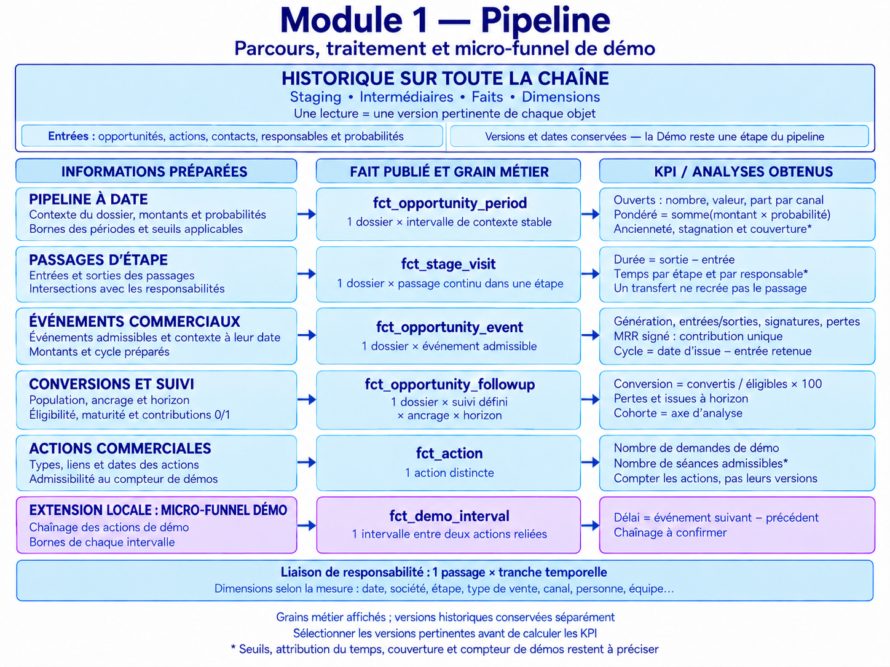
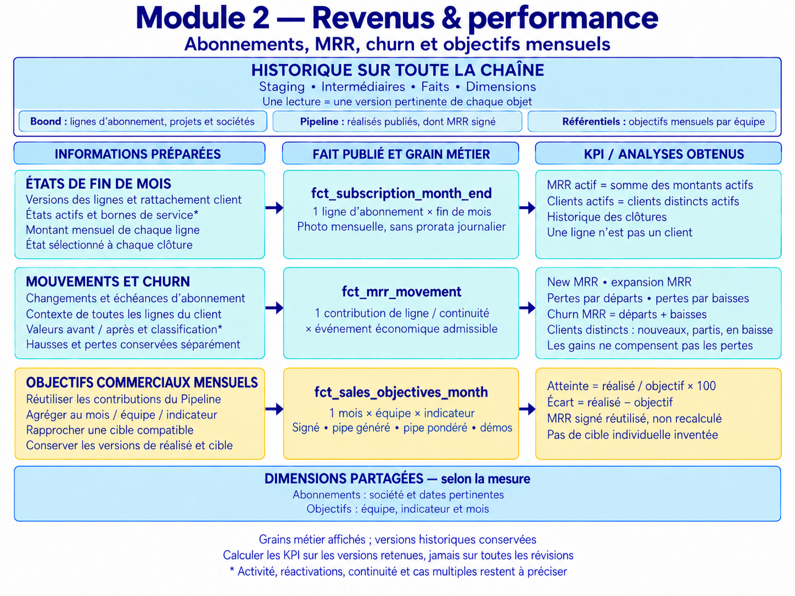
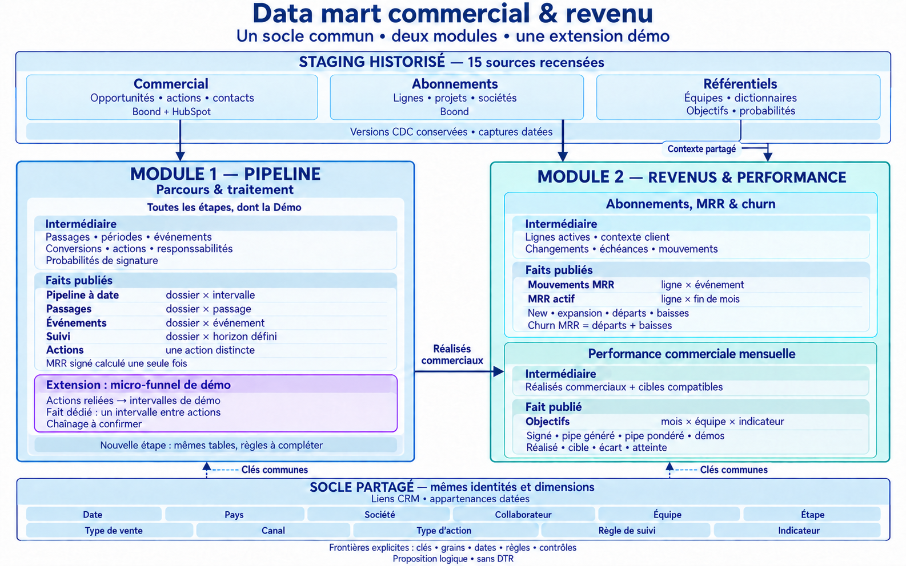
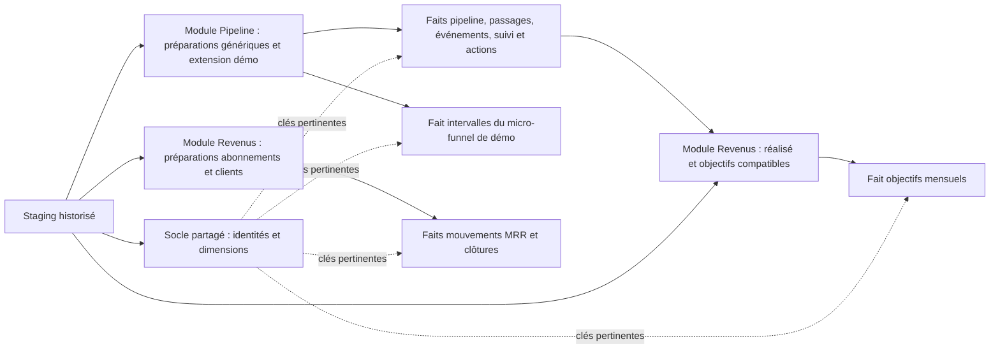
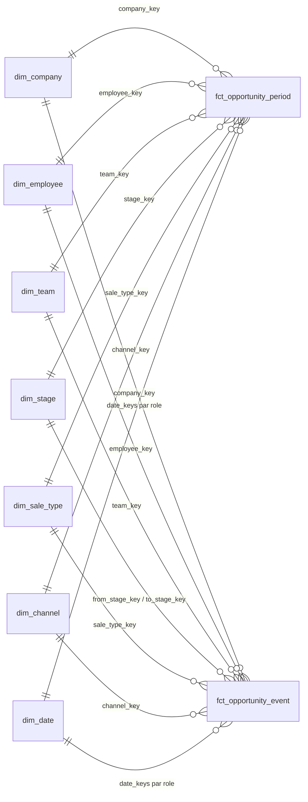
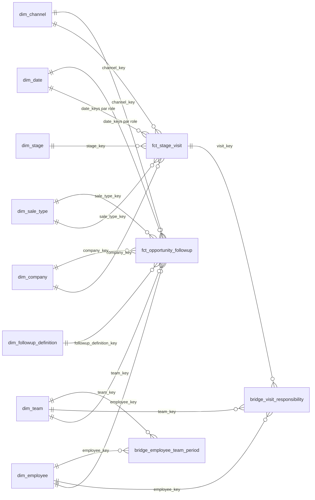
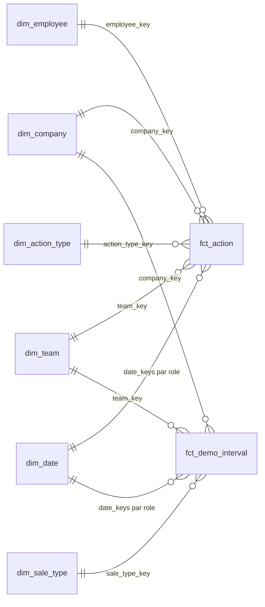
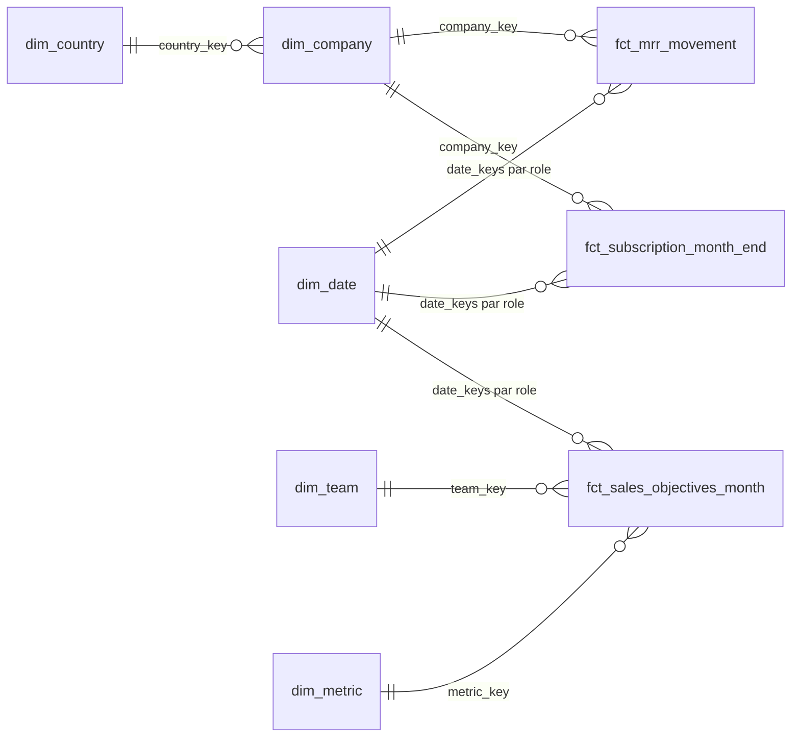

# Proposition de modèle — intermédiaire, faits et dimensions

**Règle actuelle — échange 24 : New MRR inclut les upsells.** `New MRR total = composante New + composante Upsell`. Filtre demandé : **New / Upsell**. New conserve les entrants et retours après churn déjà retenus ; Upsell correspond à la hausse nette active des sociétés restées actives. L’expansion est donc une composante du total New MRR, pas un montant à ajouter une deuxième fois. `MRR fin = MRR début + New MRR total − churn MRR`, à périmètre et unité identiques, corrections explicites. [Décision DU-38](questions_decisions.md#du-38).

**Échange 23 :** « Nb In demo » compte les **sociétés distinctes** ayant au moins une opportunité en phase Démo à la date observée : deux dossiers de la même société = un prospect. Pour l’upsell de 100 à 150 €/mois, seule la contribution **supplémentaire de 50 €/mois** est retenue pour le case. Dans sa réponse au montant signé, l’utilisateur écrit « 50 euros en new mrr » : le montant incrémental est décidé ; l’échange 24 inclut ensuite les upsells dans New MRR avec filtre New / Upsell. [Décisions et clarification](questions_decisions.md#du-36).

**Mise à jour métier — échange 22 :** entrée à la création Boond après soumission du formulaire ; démos réellement réalisées distinctes de « Nb In demo » ; signature dès « Signé — formalités à finaliser » ; client actif = société avec au moins un abonnement en cours à clôture. Pour le case : réactivations incluses dans New MRR, variation nette par société entre clôtures, départ-retour intra-mois hors périmètre, bloc MRR actif/churn global sans filtre équipe. [Décisions de l’échange 22](questions_decisions.md#du-28). Le supplément signé d’upsell et le grain société de Nb In demo sont précisés à l’échange 23 ; données sources des montants et critères d’activité restent à préciser ; nomenclature New MRR résolue à l’échange 24.

**Actualisation de la proposition :** les contributions de MRR du case sont désormais calculées au grain société × mois × composante après comparaison des clôtures ; les lignes et changements sources restent conservés. Les PNG et prompts des échanges 18–19 sont des vues historiques : leur grain « mouvement de ligne » et certains points ouverts ne sont pas la définition actuelle. Aucun modèle physique n’est implémenté.

**Statut : proposition modulaire actualisée à l’échange 19, à discuter. Aucun modèle n’est implémenté.** Les noms de tables et de champs ci-dessous sont proposés. Ils ne désignent pas des colonnes déjà présentes dans ClickHouse. La première architecture de l’échange 9 reste retirée ; cette proposition repart de l’inventaire de staging élaboré ensuite.

Le besoin de référence est la [liste humaine des KPI approuvée](liste_kpi_humaine.md). Le [catalogue détaillé](catalogue_indicateurs_ia.md) conserve les demandes, les sources, les hypothèses optionnelles et les définitions ouvertes. Les arbitrages métier restent dans le [registre](questions_decisions.md).

<a id="historisation-toutes-couches"></a>
## Historisation de toute la chaîne — précision de l’échange 19

**Exigence utilisateur : tout le modèle doit être historisé.** Le libellé « staging historisé » du dessin d’ensemble ne limitait pas volontairement l’histoire au staging, mais la présentation était insuffisamment explicite. La règle s’applique au staging, aux intermédiaires, aux faits, aux dimensions et aux liaisons. Les vues détaillées ci-dessous la rendent visible.

### Un historique exploitable à chaque couche

| Couche | Histoire à conserver et exposer | Exemple de lecture |
|---|---|---|
| Staging | Versions sources, suppressions et captures datées ; identité et provenance | Retrouver les états observés d’un besoin ou d’une ligne d’abonnement |
| Intermédiaire | Périodes et transitions reconstruites, événements, attributions datées, contributions et traces de révision des calculs | Reconstituer les passages successifs, le responsable pertinent ou la classification d’un mouvement |
| Faits | Événements et observations historiques à leur grain, avec versions/corrections traçables ; aucune réduction au seul état courant | Lire le pipe à une date, les signatures d’un mois, une cohorte à horizon ou chaque clôture MRR |
| Dimensions et référentiels | Versions des attributs et mappings qui évoluent : équipe, canal, libellés, coefficients, définitions, cibles… | Appliquer le contexte et les règles correspondant à la lecture choisie |
| Liaisons | Validité temporelle et versions des liens entre identités, personnes, équipes et passages | Attribuer une tranche de durée au responsable pertinent sans multiplier la durée totale |

Les tables techniques générées, comme le calendrier, conservent leur contenu et la traçabilité de leurs règles. Une valeur inchangée n’a pas besoin d’être recopiée quotidiennement pour être utilisable dans l’histoire. Les référentiels ou règles qui changent doivent en revanche rester versionnés. Cette distinction ne soustrait aucune couche à l’exigence d’historisation.

### Grain métier et version historique sont deux choses différentes

Les schémas affichent le **grain métier** : une action, un passage, un événement, une contribution de ligne ou une clôture. Une même unité peut posséder plusieurs versions observées ou recalculées. Conserver trois versions d’une action ne crée pas trois démos ; corriger une signature ne crée pas automatiquement une nouvelle signature.

Les clés `action_key`, `event_key`, `visit_key`, etc. identifient les unités logiques proposées. **Elles ne suffisent pas à elles seules comme clés physiques uniques si plusieurs révisions de cette unité sont stockées.** Il faudra distinguer identité de l’unité et identité de sa version, avec une clé candidate de version adaptée à chaque modèle. Le schéma relationnel représente la lecture des versions pertinentes ; sa cardinalité ne permet pas une jointure sur toutes les révisions sans sélection temporelle.

Exemple : l’action A possède une première version planifiée, une seconde replanifiée et une troisième avec un autre statut. L’histoire conserve les trois versions. Pour un compteur donné, la règle choisit la version et l’événement admissibles, puis compte l’action distincte. Le mécanisme physique de stockage, les clés et la règle d’admissibilité restent à spécifier.

### Évolution métier, corrections et moment de connaissance

Conserver séparément, quand elles sont connues : la date métier d’effet, la date d’observation/publication, la date d’import et la version de règle ou de calcul. Une ancienne période peut être corrigée par une information arrivée plus tard ; sa trace ne doit pas être effacée par un simple remplacement de tout le passé par le dernier résultat.

**À préciser pour les restitutions :** veut-on afficher le passé corrigé avec les informations les plus récentes, le passé tel qu’il était connu à une date, ou les deux lectures ? La conservation et la traçabilité sont requises ; la vue par défaut et les modalités de reproduction restent en QC-10/QC-09. Cette question ne remet pas l’historisation en discussion et n’autorise pas à inventer un passé non observé.

Les métadonnées de version et de provenance sont à concevoir selon le grain. Aucun nom de colonne, modèle bitemporel généralisé, copie quotidienne ou stratégie de matérialisation n’est imposé ici. Une vue reste possible si elle expose effectivement l’histoire requise ; une vue du seul dernier état ne répond pas à cette exigence. Le choix d’un incrémental n’est pas, en lui-même, une garantie d’historisation.

### Lecture et calcul des KPI

Pour une analyse, sélectionner le périmètre, les dates et les versions pertinentes, puis agréger les contributions admissibles. Les ratios se recomposent avec des numérateurs et dénominateurs compatibles. Les stocks ne s’additionnent pas entre dates ; les compteurs d’actions, dossiers et clients utilisent leur identité distincte pertinente.

La formule abrégée « conversion = convertis / éligibles » des images signifie le nombre de dossiers admissibles convertis divisé par le nombre de dossiers éligibles d’une même définition, population, ancrage et horizon. Le compteur ne doit pas additionner les révisions ou les ancrages incompatibles. Une moyenne de durées reste à définir ; la durée unitaire peut déjà être préparée à son grain.

**Historisation et rétention sont distinctes.** La durée de cinq ans est décidée pour les agrégats. La durée de conservation des données détaillées, intermédiaires et versions reste à arbitrer en QC-07 ; aucun nouveau délai n’est décidé par l’échange 19.

<a id="vues-detaillees-modules"></a>
## Vues détaillées des deux modules — échange 19

Les deux images ont le même format et la même structure de lecture : **informations préparées → fait publié et grain métier → KPI ou analyses obtenus**. La dernière colonne décrit les mesures obtenues à partir des contributions ; elle ne prétend pas que chaque taux agrégé est figé sur chaque ligne du fait. Les intermédiaires et leurs noms complets restent recensés dans le catalogue des modèles.

### Module Pipeline — six faits et une liaison de temps



La ligne d’action, le passage commercial et l’intervalle du micro-funnel restent trois unités différentes. La liaison de responsabilité porte une tranche temporelle, sans dupliquer la durée entière du passage. Les populations et dates admissibles restent conditionnées aux règles ouvertes du registre. Les démos restent incluses dans le noyau du pipeline ; seul leur chaînage spécifique constitue l’extension.

### Module Revenus et performance — trois faits



Les états de fin de mois et mouvements économiques restent distincts. La somme du MRR d’une ligne ne doit pas être multipliée une seconde fois par sa quantité ; les clients sont comptés distinctement. Les montants de départ et de baisse ne se compensent pas avec New MRR/expansion. Les réalisés commerciaux, dont MRR signé, sont réutilisés depuis le module Pipeline pour les objectifs ; aucune cible individuelle ou cible de churn n’est ajoutée.

**Limites des formules abrégées :** population admissible, unité, devise et version de référence doivent être compatibles. Un objectif nul ou inconnu ne produit pas automatiquement 0 % d’atteinte. Les formules détaillées, les règles de multiples et les questions non tranchées restent dans le catalogue et le registre.

Les illustrations sont créées par l’outil intégré de génération d’image, à partir du style de la vue d’ensemble, puis vérifiées et corrigées. Elles décrivent une proposition, pas des tables déjà implémentées. La mention des versions « séparément » dans l’image Pipeline distingue version et unité métier ; elle ne prescrit pas une base ou table physique distincte par version.

<a id="architecture-modulaire"></a>
## Vue actuelle — deux modules et une extension démo



**Lecture actuelle :** l’historisation s’applique à toutes les couches, conformément à l’échange 19 ; le seul intitulé « staging historisé » du dessin d’ensemble ne doit pas être lu comme une restriction. Les vues détaillées ci-dessus explicitent cette portée.

**Orientation utilisateur, échange 18 :** la démonstration fait partie du pipeline. Les mêmes questions de stock, conversion, durée, stagnation et responsabilité s’appliquent aux autres étapes. Seul son micro-funnel justifie une extension spécifique. L’ensemble doit être organisé en deux modules réutilisant les dimensions partagées.

**Proposition de mise en œuvre logique :** nommer l’ensemble « Data mart commercial & revenu », avec un module **Pipeline — parcours et traitement** et un module **Revenus et performance**. Ce sont deux domaines d’un même ensemble analytique ; pas deux copies des données et pas nécessairement deux bases ou déploiements. Le terme « pipeline » seul est trop étroit pour nommer la source de tout le revenu : le portefeuille d’abonnements doit être alimenté directement depuis Boond, même sans lien commercial démontré.

Le dessin montre les dépendances principales et les responsabilités, avec des noms et grains raccourcis. Les référentiels fournissent les valeurs utiles à chaque module — notamment probabilités au pipeline et cibles à la comparaison mensuelle — sans répéter chaque flèche. Les dimensions sont communes mais ne s’appliquent qu’aux faits pertinents. « Suivi — dossier × horizon défini » conserve le grain complet dossier × définition de suivi × ancrage admissible × date/horizon. « Ligne × événement » conserve la notion de continuité et d’événement économique admissible.

### Module 1 — Pipeline : un noyau commun à toutes les étapes

Les préparations construisent les périodes de contexte, passages continus, événements, contributions aux conversions, actions et responsabilités. Qualification, découverte, Démo ou une future étape sont des valeurs/règles de parcours ; elles ne possèdent pas chacune leur copie de ces tables.

Les cinq faits génériques sont `fct_opportunity_period`, `fct_stage_visit`, `fct_opportunity_event`, `fct_opportunity_followup` et `fct_action`. Ils portent des mesures ou contributions à grain fin, utilisables globalement, par équipe, canal ou personne quand l’attribution est établie. Le MRR signé reste une contribution canonique de l’événement de signature, sous réserve de sa définition et de la nature mensuelle du montant.

`int_actions_prepared` et `fct_action` deviennent explicitement génériques : les types d’actions utiles, dont demandes et démos, restent distingués. Les indicateurs de démo servent à sélectionner leur population ; ils ne réduisent pas toute la table aux démos. Conserver des types d’action n’ajoute pas automatiquement des KPI à la liste métier.

**Extension locale démo :** `int_demo_intervals` → `fct_demo_interval` prépare les délais entre actions de démo dont le chaînage est établi. Les séances continuent à être comptées dans `fct_action`, la phase commerciale dans les faits d’étape. L’extension ne duplique ni les actions ni les passages. Une action de démo ne prouve pas son rattachement à un passage précis de l’opportunité ; les liens inconnus restent inconnus.

### Module 2 — Revenus et performance

La branche **abonnements / MRR / churn** prépare les périodes de lignes, changements et échéances, contexte de toutes les lignes d’un client, classifications de mouvements et clôtures. Elle publie `fct_mrr_movement` et `fct_subscription_month_end`. Son alimentation vient directement des abonnements/projets/sociétés Boond ; elle n’exige pas un lien prouvé avec une signature ou un upsell pour mesurer un état ou mouvement admissible. Un enrichissement commercial facultatif ne doit pas transformer l’absence de lien en absence de revenu.

La branche **comparaison commerciale mensuelle** utilise les contributions publiées par le module Pipeline et `ref.sales_targets`, puis prépare `int_sales_objectives_month` → `fct_sales_objectives_month`. Les quatre objectifs restent MRR signé, pipeline généré, pipeline pondéré et démos. Aucun objectif de MRR actif/churn ni cible individuelle n’est ajouté.

« Performance » ne signifie pas que toutes les analyses individuelles migrent ici : les durées, stagnations et conversions individuelles restent des lectures des faits du pipeline. Les comparaisons financières et aux objectifs utilisent les faits pertinents, sans les dupliquer.

### Répartition des modèles : une seule table propriétaire par rôle

| Périmètre | Intermédiaires propriétaires | Faits / liaisons publiés |
|---|---|---|
| Pipeline — noyau générique | `int_signature_probabilities`, `int_opportunity_stage_visits`, `int_opportunity_periods`, `int_opportunity_events`, `int_opportunity_followup`, `int_actions_prepared`, `int_visit_responsibility` | `fct_opportunity_period`, `fct_stage_visit`, `fct_opportunity_event`, `fct_opportunity_followup`, `fct_action`, `bridge_visit_responsibility` |
| Pipeline — extension démo | `int_demo_intervals` | `fct_demo_interval` |
| Revenus — abonnements et mouvements | `int_subscription_periods`, `int_subscription_changes`, `int_client_activity_context`, `int_mrr_movements`, `int_subscription_month_end` | `fct_mrr_movement`, `fct_subscription_month_end` |
| Revenus/performance — comparaison mensuelle | `int_sales_objectives_month` | `fct_sales_objectives_month` |
| Socle commun | `int_crm_identity_links`, `int_team_membership_periods` | `bridge_employee_team_period` et les onze dimensions partagées existantes |

Les quinze sources de staging et leurs colonnes restent celles de l’inventaire. La proposition conserve **seize intermédiaires, neuf faits, onze dimensions et deux liaisons** ; le changement porte sur leurs responsabilités, interfaces et le caractère générique des actions. Ces modèles sont logiques : aucune matérialisation systématique ni base supplémentaire n’est imposée.

### Dépendance entre modules : des sorties publiées, sans copie du calcul

| Producteur | Consommateur | Contrat de lecture proposé |
|---|---|---|
| Pipeline : `fct_opportunity_event` | `int_sales_objectives_month` | Contributions de génération et de signature admissibles, dont MRR signé ; IDs, date, équipe pertinente, unité, éligibilité et version de règle conservés |
| Pipeline : `fct_opportunity_period` | `int_sales_objectives_month` | Une période admissible par dossier à la clôture ; montant pondéré et équipe à cette date, sans somme des versions |
| Pipeline : `fct_action` | `int_sales_objectives_month` | Actions admissibles au compteur de démos retenu, avec équipe et date du compteur ; convention encore ouverte |
| Référentiel `sales_targets` | `int_sales_objectives_month` | Une cible/version compatible par mois/équipe/indicateur, rapprochée après agrégation du réalisé |
| Socle partagé | Chaque module concerné | Identités, versions temporelles et mappings communs ; inconnu et qualité conservés plutôt que rattachement supposé |

Une sortie de fait publiée par un module peut alimenter la préparation intermédiaire d’un autre : les couches s’organisent **à l’intérieur de chaque module**. Cette dépendance reste dirigée Pipeline → comparaison mensuelle. Le pipeline ne dépend pas de ses objectifs ; la couverture sera lue en rapprochant des contributions compatibles, pas par une boucle de préparation. Le module financier ne recrée pas les événements de signature et ne déduit pas le MRR actif du MRR signé.

### Ajouter une étape ou un autre sous-parcours

Pour une étape classique, compléter le référentiel d’étapes, les règles d’éligibilité et les définitions de suivi/conversion, ainsi que la probabilité si elle est nécessaire. Les mêmes faits continuent à stocker les périodes, passages et événements. Les règles et transitions sont propres au parcours — nouvelle vente, upsell… — sans imposer un ordre fondé sur les codes numériques. Un nouveau code non encore qualifié reste identifiable et signalé ; il ne doit pas disparaître par un filtre codé en dur.

Une extension est justifiée si une étape introduit un **grain ou des événements spécifiques** : plusieurs séances, documents ou autres objets reliés. Le micro-funnel de démo constitue cette extension locale aujourd’hui. Si un futur sous-parcours partage exactement ce grain et ces règles, sa généralisation sera examinée alors ; aucune table universelle supplémentaire n’est créée par anticipation.

### Ce qui apporte la stabilité et la fiabilité

Le découpage rend les dépendances et les responsabilités plus claires ; il ne garantit pas à lui seul la qualité. La proposition prévoit des contrats de clés, grains, unités, dates et versions de règles, une logique de mesure unique et des contrôles à chaque frontière. Les changements de règles partagées devront être répercutés explicitement chez leurs consommateurs.

Les contrôles à définir couvriront notamment la complétude du staging, l’unicité des clés, les périodes sans chevauchement, les réentrées, les attributions, les contributions non doublées, les sources tardives et la réconciliation MRR. Une extension de démo non calculable doit laisser les faits génériques disponibles avec leurs propres statuts ; un agrégat dépendant incomplet ne doit pas être présenté comme complet. Ce sont des dispositions de conception à spécifier et tester, pas une fiabilité déjà mesurée.

Les règles métier ouvertes — entrée qualifiée, compteur de démos, activité des abonnements, mouvements multiples, etc. — restent dans le registre. Le regroupement modulaire ne les tranche pas. Les choix physiques dbt/ClickHouse, l’orchestration fine et les DTR restent hors de cette proposition.

**Traçabilité visuelle :** l’[ancienne vue d’ensemble](maquettes/architecture_vue_ensemble_v1.png) est conservée comme version de l’échange 16 ; son découpage en quatre bandes est remplacé par cette organisation. L’image actuelle a été produite avec l’outil intégré de génération d’image puis vérifiée, avec correction d’un connecteur et du pied de page. Les noms courts du dessin renvoient au catalogue ci-dessous.

**Lecture complémentaire :** [clés et cardinalités](#schema-relationnel).

## L’idée générale

**Préparer les calculs à un grain fin, puis publier des faits et des dimensions réutilisables.** Un grain désigne ce que représente exactement une ligne d’une table : un passage dans une étape, une action de démo, une contribution d’abonnement à une fin de mois…

- **Staging déjà recensé** : conserve les données sources et leur histoire. Il reste défini par l’[inventaire des 15 sources et 159 colonnes](inventaire_sources_staging.md), avec leurs JSON et le protocole CDC.
- **Intermédiaire** : reconstitue les périodes et événements, résout les relations, applique les règles métier et prépare les montants, durées et contributions aux compteurs/taux.
- **Faits** : exposent ces résultats avec un grain stable et les clés des dimensions. Ils gardent le détail nécessaire pour filtrer et approfondir les analyses.
- **Dimensions** : fournissent les axes partagés : société, équipe, personne, étape, canal, date… Deux tables de liaison portent les relations qui changent dans le temps.

Les DTR et le dashboard ne sont pas conçus dans cette proposition. La séparation logique ne signifie pas que chaque modèle doive être stocké physiquement : vues, tables et incrémental seront choisis plus tard. En particulier, un fait ne justifie pas de recopier physiquement une préparation identique.



## Les faits proposés, en une lecture

| Fait | Une ligne représente… | Ce qu’il rend calculable |
|---|---|---|
| `fct_opportunity_period` | Une opportunité pendant un intervalle où son contexte analytique reste stable | Pipe ouvert en nombre/valeur, pondération, part de canal, ancienneté et stagnation à une date, couverture si cible compatible |
| `fct_stage_visit` | Un passage continu d’une opportunité dans une étape | Durée terminée, passages successifs et phase Démo ; transfert de responsable sans remise à zéro du passage |
| `fct_opportunity_event` | Un événement commercial admissible d’une opportunité | Génération, entrées/sorties d’étapes, signatures, pertes, MRR signé et durée du cycle |
| `fct_opportunity_followup` | Un dossier × une définition de suivi × un ancrage admissible × un horizon/date | Contributions aux conversions, pertes et issues à horizon ; la cohorte est un attribut de regroupement |
| `fct_action` | Une action commerciale distincte, avec son type | Socle générique ; compteurs de demandes de démo et séances admissibles, Démo 1 et complément séparés |
| `fct_demo_interval` | Un intervalle entre deux événements d’un parcours de démo établi | Délai demande→séance ou entre séances, **si le chaînage est démontré** |
| `fct_mrr_movement` | Une contribution société × mois × composante de variation entre clôtures, détail source conservé | New MRR, expansion, pertes par départ et baisse ; nouveaux clients, départs et clients en baisse par décompte distinct |
| `fct_subscription_month_end` | Une ligne d’abonnement à une fin de mois observable | MRR actif sans prorata et clients actifs distincts |
| `fct_sales_objectives_month` | Une équipe × un mois × un des quatre indicateurs ciblés | Réalisé, objectif, écart et composantes du taux d’atteinte |

### Pourquoi conserver plusieurs tables pour le pipeline ?

Un dossier peut rester 20 jours en Qualification et changer de responsable au dixième jour. Il possède alors **un passage de 20 jours**, mais **deux périodes de responsabilité**. Confondre ces grains fausserait la durée de l’étape ou attribuerait 20 jours à chaque personne. La liaison `bridge_visit_responsibility` conserve les intersections temporelles, sous réserve de la convention d’analyse individuelle.

De même, un stock de dossiers ouverts à une date, un flux de signatures dans le mois et une conversion de population suivie ne s’additionnent pas entre eux. Leurs faits sont séparés pour préserver ces sens.

### Où les KPI sont-ils « précuisinés » ?

Les intermédiaires préparent les contributions : montant pondéré par dossier, durée de passage, événement de signature, pertes MRR classées et indicateurs d’éligibilité. Les faits les exposent sans réinterpréter les règles métier.

Un taux de conversion reste `Σ contributions converties / Σ contributions éligibles × 100` **à définition, ancrage et horizon compatibles**. Un total de taux ou une moyenne de pourcentages d’équipes serait incorrect. Les décomptes de clients utilisent l’identité client distincte, pas le nombre de lignes d’abonnement. Un ancienneté à une date arbitraire utilise les bornes conservées ; elle n’est pas figée à la date du dernier chargement.

Le fait d’objectifs est volontairement mensuel : les cibles n’existent qu’à ce grain. Les contributions commerciales détaillées restent disponibles dans leurs propres faits. Les objectifs sont rapprochés après agrégation d’un réalisé compatible, jamais répétés sur chaque opportunité.

## Règles communes de modélisation proposées

| Sujet | Règle de conception et limite |
|---|---|
| Identités | Conserver tenant + identifiant naturel pour les objets Boond, les IDs source et les clés de version. Une clé technique ne remplace pas l’identité distincte d’un client/dossier. Les clés sont candidates tant que leur unicité n’est pas testée. |
| Trois temporalités | Distinguer date métier prouvée, observation CDC/capture et import. `meta.ts` ne devient pas automatiquement date de qualification, signature ou résiliation. Conserver la provenance temporelle et les périodes non observables. |
| Périodes | Proposition d’intervalles semi-ouverts `[début, fin)` pour éviter les doubles lectures aux frontières ; précision/fuseau et date métier de référence restent à spécifier. Une période s’arrête aussi sur une suppression connue, sans transformer cette suppression en perte ou churn métier. |
| Dimensions historiques | Historiser seulement les attributs dont les changements modifient la lecture analytique. Résoudre une seule version à la date pertinente. Pour un fait par intervalle, découper aux bornes utiles afin que les clés de dimensions restent valides pendant toute la période. Pas de passé reconstitué sans observation. |
| Attribution | Pipe à date : responsable à cette date ; génération/signature : responsable à l’événement retenu. Canal d’acquisition proposé fixé à l’entrée. Les mappings et priorités de sources restent à confirmer en QC-05/QM-02. |
| Inconnus | Garder NULL, statut de qualité et provenance ; ne pas fabriquer un zéro, une démo tenue ou une conversion échouée. Un calcul incomplet ne doit pas être publié comme total exhaustif. |
| Montants | Conserver nature, devise connue et unité. Pondérer un montant de contrat ne produit pas du MRR. Le montant mensuel documenté de la ligne d’abonnement inclut déjà la quantité ; ne pas la multiplier deux fois. |
| Populations | Conserver nouvelles ventes, upsells et autres types en amont. Appliquer l’éligibilité propre à chaque mesure ; aucune suppression générale `where new` dans la préparation commune. |
| Additivité | Stocks : une observation à la fois. Flux : événements admissibles sans doublons. Durées : garder les observations fines, ne pas sommer pour fabriquer une moyenne. Ratios : recomposer depuis numérateur/dénominateur. Ne pas additionner devises/unités incompatibles. |
| Multiplicités | Un contact peut concerner plusieurs dossiers ; une société plusieurs projets/lignes. Un lien candidat ou multiple ne doit pas multiplier les montants ni les actions. Ne pas joindre deux faits détaillés entre eux sur la seule société. |
| Traçabilité | Prévoir clés source/version, version de règle, statut de calcul et informations de lot/couverture utiles. Les groupes de champs du catalogue ci-dessous sont conceptuels, pas un DDL final. |

Les décisions métier proviennent de l’intent et de la liste approuvée ; **les noms, découpages de tables, clés et intervalles techniques sont des propositions IA**, à valider dans la prochaine itération.

## Couverture de la liste des KPI

| KPI ou famille sans doublon | Préparation → fait principal | Complément / limite |
|---|---|---|
| Nombre et valeur d’opportunités générées | `int_opportunity_events` → `fct_opportunity_event` | Événement d’entrée qualifiée QM-06 ; valeur à l’entrée |
| Nombre, valeur et valeur pondérée du pipe ouvert | `int_opportunity_periods` → `fct_opportunity_period` | Une période admissible à la date ; nature des montants, probabilités et population |
| Part de canal ; couverture d’objectif | Même fait de périodes | Part recalculée après filtre ; couverture rapproche une cible compatible agrégée, sans multiplication des lignes |
| Entrées/sorties d’étape ; signatures ; opportunités perdues | `int_opportunity_events` → `fct_opportunity_event` | DISTINCT dossier selon période/étape ; 1→14 n’est pas une deuxième signature |
| Conversion A→B ; perte après A ; effectifs et proportions des issues à horizon | `int_opportunity_followup` → `fct_opportunity_followup` | Éligibilité, maturité et observabilité ; aucune table de « KPI cohorte » |
| Ancienneté actuelle ; nombre/valeur stagnants | Périodes et passages → `fct_opportunity_period` | Date d’analyse et seuil à définir ; champ `stagnant_from` dérivable seulement après arbitrage |
| Durée de passage terminé ; durée de cycle | Passages / événements → `fct_stage_visit` / `fct_opportunity_event` | Unité de durée, pauses et synthèse moyenne/médiane ouvertes |
| Délai du sous-parcours de démo | `int_demo_intervals` → `fct_demo_interval` | Conditionnel au chaînage et à la réalité des événements |
| Demandes et nombre de séances de démo | `int_actions_prepared` → `fct_action` | Comptage prévu/tenu, annulations et compteur de cible ouverts |
| MRR actif ; clients actifs | `int_subscription_month_end` → `fct_subscription_month_end` | Fin de mois, lignes actives ; DISTINCT client, activité ≠ montant strictement positif |
| MRR signé | `int_opportunity_events` → `fct_opportunity_event` | Signature admissible et mensualité récurrente prouvées ; valeur incrémentale d’upsell à préciser |
| New MRR ; expansion ; pertes par départ et baisse ; churn total | `int_mrr_movements` → `fct_mrr_movement` | Pertes positives : départ + baisse nette par société ; pas compensation entre sociétés, retours dans New MRR |
| Nouveaux clients ; churn clients ; clients en baisse | Même fait de mouvements + contexte client préparé | DISTINCT client sur événements admissibles ; activité à montant zéro conservée ; retours/chevauchements ouverts |
| Atteinte et écart des quatre objectifs | `int_sales_objectives_month` → `fct_sales_objectives_month` | Mois/équipe/indicateur, aucune cible individuelle inventée |
| MRR potentiel moyen proposé par le brief ; activité nécessaire pour le BP | Contributions commerciales conservées ; **aucun calcul publié pour ces deux attentes** | Définitions/formules manquantes QC-04. La couverture reste explicitement ouverte ; elles ne sont pas supprimées. |

Les vues globales, par équipe, individuelles, par canal, par type de vente et par cohorte s’appuient sur les axes pertinents. Ils ne s’appliquent pas automatiquement à tous les faits. En particulier, aucun rattachement équipe/canal du MRR actif n’est affirmé sans règle démontrée.

## Relations et prévention des doubles comptes

| Relation | Cardinalité / lecture proposée |
|---|---|
| Fait → version de dimension | Plusieurs lignes de fait vers une version au plus ; inconnu explicite si rattachement non résolu. Une date a plusieurs rôles possibles, donc plusieurs clés de date peuvent exister dans un même fait. |
| Opportunité → périodes / passages / événements | Une opportunité vers plusieurs lignes de chaque fait ; chaque fait garde sa propre clé. Les IDs de dossier relient les recherches de détail, pas une jointure multiplicative pour les agrégats. |
| Passage → `bridge_visit_responsibility` | Un passage vers plusieurs tranches de responsabilité ; analyser `slice_duration` pour la ventilation, ne pas répéter la durée totale du passage. |
| Collaborateur → `bridge_employee_team_period` | Plusieurs appartenances datées possibles ; ne pas multiplier les faits si plusieurs équipes sont observées. Les faits exposent l’équipe retenue par la convention ou un statut ambigu. |
| Ligne d’abonnement → projet → société | Chaîne documentée via `raw.deliveries.relationships.project.data.id` et `raw.projects.relationships.company.data.id` ; unicité et validité temporelle à vérifier. |
| Mouvement → ligne/continuité → contexte client | Une contribution par ligne ; contexte de toutes les lignes avant/après pour distinguer départ complet et baisse. Plusieurs contributions d’un même départ ne font qu’un client parti. |
| Réalisés → objectifs | Agréger au mois/équipe/indicateur avant jointure à une cible/version ; pas de croisement entre détail commercial et cibles brutes. Le global se recalcule avec les sommes compatibles. |
| Boond ↔ HubSpot / actions ↔ dossiers | Relations qualifiées dans `int_crm_identity_links`. Un deal et une opportunité correspondante ne sont pas deux affaires. Une action liée au contact ne prouve pas son rattachement à l’un de ses dossiers. |

Il n’est pas nécessaire de créer une dimension pour chaque objet source. Les IDs de contact, projet, opportunité, action et ligne restent dans les faits/intermédiaires pour le détail. Une dimension supplémentaire ne sera justifiée que par des attributs ou usages clairement nécessaires.

## MRR : préserver la photographie et les mouvements

`int_subscription_periods` prépare les états de ligne. Deux branches en partent : l’une sélectionne les états de fin de mois ; l’autre identifie des changements puis les classe avec le contexte du client. **Un changement de version CDC n’est pas encore un événement financier.** Les remplacements de lignes, corrections et dates d’effet doivent être qualifiés.

Le MRR perdu par départ et le MRR perdu par contraction restent deux contributions séparées. Une expansion peut être mesurée dans l’abonnement même si aucun lien certain avec un dossier d’upsell n’est établi. Le lien commercial reste alors absent/ambigu ; il n’est pas inventé pour compléter le schéma.

Une réconciliation devra expliquer : `MRR fin = MRR début + New + expansion − départs − baisses + autres variations classées`. Les réactivations et corrections restent dans des catégories explicites à arbitrer ; elles ne sont pas réparties arbitrairement. L’écart ne peut être validé qu’avec les mêmes bornes et une histoire suffisamment complète. Aucun écart de réconciliation ni montant d’une catégorie inconnue ne devient un KPI demandé.

## Ce qui reste à décider avant de coder les calculs concernés

| Décision manquante | Tables / mesures dépendantes | Référence |
|---|---|---|
| Entrée dans le pipeline qualifié, pertes/signatures admissibles et populations par mesure | Événements, conversions, génération, cycle, MRR signé | [QM-06](questions_decisions.md#qm-06), [QC-01](questions_decisions.md#qc-01), [QM-04](questions_decisions.md#qm-04) |
| Nature des montants, coefficient retenu et application aux upsells | Pondération, couverture, MRR signé, objectifs compatibles | [QM-05](questions_decisions.md#qm-05), [QC-04](questions_decisions.md#qc-04), [QC-11](questions_decisions.md#qc-11) |
| Réalisation des démos, compteur cible et chaînage des actions | Actions admissibles, intervalles de démo, objectif démo | [QC-02](questions_decisions.md#qc-02), [QC-09](questions_decisions.md#qc-09) |
| États/périodes actifs, continuité de ligne, réactivations et regroupements/compensations de mouvements | Clôtures MRR, New, expansion, churn/clientèle | [QM-04](questions_decisions.md#qm-04), [QC-12](questions_decisions.md#qc-12), [QC-13](questions_decisions.md#qc-13) |
| Canal retenu/Inbound, équipe, membres multiples, allocation du temps individuel | Dimensions, périodes, événements, liaison de responsabilité | [QM-02](questions_decisions.md#qm-02), [QC-05](questions_decisions.md#qc-05), [QC-14](questions_decisions.md#qc-14) |
| Seuils de stagnation, pauses, horizons/maturité et couverture historique | Passages, suivi, stock stagnant | [QC-03](questions_decisions.md#qc-03), [QC-10](questions_decisions.md#qc-10) |
| Révisions de cibles/coefficients, calendrier de référence, rétention détaillée et cadence | Reproductibilité historique et organisation des traitements | [QC-06](questions_decisions.md#qc-06), [QC-07](questions_decisions.md#qc-07), [DCI-13](questions_decisions.md#dci-13) |

Dans ce case, l’utilisateur arbitre ; les personnes métier à consulter en situation réelle restent identifiées dans le registre. Ces manques n’empêchent pas de proposer les grains et de préparer les dépendances indépendantes. Ils empêchent de présenter tous les calculs comme prêts à coder.

## Incrémental et vérifications à prévoir

Le protocole [CDC déjà retenu](inventaire_sources_staging.md#incremental-cdc) demeure applicable au staging concerné. Il ne peut pas être recopié tel quel sur tous les modèles dérivés : une version reçue tard peut changer un passage ancien, ses événements, les suivis suivants et plusieurs clôtures. Il faudra retraiter les entités et horizons affectés, ou recalculer le modèle si son faible volume le permet.

Les contrôles à prévoir portent sur les clés/versions, les intervalles sans chevauchement, les événements non doublés, la cardinalité des liens, l’unicité équipe/mois/mesure/cible, les contributions de conversion, l’absence de double comptage des pertes MRR, les réconciliations et la couverture historique. Ils ne sont **pas exécutés** dans cette proposition. Aucun choix d’engine ClickHouse, de stratégie dbt, de partitionnement ou d’index n’est imposé ici.

## Catalogue des tables proposées

Les champs sont regroupés par fonction pour faciliter la lecture. En complément des champs visibles, toute table issue d’objets multi-tenant doit préserver le tenant dans ses identités et ses jointures. Les groupes `*_key` désignent des clés à construire, pas des colonnes d’extraction. Les dates et durées calculées restent conditionnelles à la disponibilité d’événements admissibles.

### Rappel des entrées — blocs de lecture, pas nouvelles tables de staging

<a id="stg-sales"></a>
#### `stg_sales` — Staging commercial

**Grain :** Versions source conservées ; captures HubSpot datées.

**Entrées :** Construction à partir des conventions validées / référentiel généré.

| Champs proposés / regroupements | Contenu |
|---|---|
| `Sources Boond` | opportunities, actions, contacts |
| `Sources HubSpot` | contacts, deals |
| `Contenu` | IDs/liens, états/types, montants, origines, agenda, versions et suppressions |

**Traitement / lecture :** Contexte seulement : les colonnes détaillées sont déjà dans l’inventaire de staging. Aucun modèle existant nommé stg_sales n’est affirmé.

**Repères dans les sources documentées :** `raw.opportunities`, `raw.actions`, `raw.contacts`, `hubspot.contacts`, `hubspot.deals`. Voir les [colonnes de staging](inventaire_sources_staging.md) pour les types et détails JSON.

<a id="stg-subscription"></a>
#### `stg_subscription` — Staging abonnements

**Grain :** Versions de lignes, projets et sociétés.

**Entrées :** Construction à partir des conventions validées / référentiel généré.

| Champs proposés / regroupements | Contenu |
|---|---|
| `Sources` | deliveries, projects, companies |
| `Contenu` | Prix/quantité, état, périodes, liens projet/client/besoin, dates CDC |

**Traitement / lecture :** Conserver les versions et leurs suppressions ; ne pas interpréter chaque version comme un mouvement financier.

**Repères dans les sources documentées :** `raw.deliveries`, `raw.projects`, `raw.companies`. Voir les [colonnes de staging](inventaire_sources_staging.md) pour les types et détails JSON.

<a id="stg-context"></a>
#### `stg_context` — Staging contexte et références

**Grain :** Grains sources distincts conservés.

**Entrées :** Construction à partir des conventions validées / référentiel généré.

| Champs proposés / regroupements | Contenu |
|---|---|
| `Organisation` | ressources, businessunits, companies, agencies, poles |
| `Dictionnaires` | Étapes, types, origines et leurs versions |
| `Références` | sales_targets et stage_probabilities, séparés |

**Traitement / lecture :** Bloc visuel regroupant des sources distinctes ; ce n’est pas une table mélangeant leurs grains.

**Repères dans les sources documentées :** `raw.ressources`, `raw.businessunits`, `raw.companies`, `raw.agencies`, `raw.poles`, `raw.dictionaries`, `ref.sales_targets`, `ref.stage_probabilities`. Voir les [colonnes de staging](inventaire_sources_staging.md) pour les types et détails JSON.

### Intermédiaires : préparer les calculs

<a id="int-crm-identity-links"></a>
#### `int_crm_identity_links` — Liens entre objets

**Grain :** Relation entre deux identités source × intervalle observé.

**Entrées :** [`stg_sales`](#stg-sales), [`stg_subscription`](#stg-subscription).

| Champs proposés / regroupements | Contenu |
|---|---|
| `link_key` | Clé de relation proposée |
| `source_object, source_id, tenant_id` | Identité et nature de l’objet de départ |
| `target_object, target_id` | Identité et nature de l’objet associé |
| `observed_from, observed_to` | Période observable du lien si disponible |
| `link_method, link_status` | Lien direct, candidat, ambigu ou absent ; preuve conservée |

**Traitement / lecture :** Rapprocher les IDs Boond/HubSpot et les rattachements action/contact/dossier. Ne pas créer toutes les combinaisons de dossiers d’un contact ; pas d’addition des montants des deux CRM. Identités et jointures avec tenant/source ; les décomptes distincts utilisent l’identité complète.

**Dépendances ouvertes :** [QC-02](questions_decisions.md#qc-02) : lien action/dossier. [QC-11](questions_decisions.md#qc-11) : lien upsell/abonnement non démontré.

**Repères dans les sources documentées :** `raw.actions.relationships.dependsOn.data.id`, `raw.actions.relationships.dependsOn.data.type`, `hubspot.contacts.properties_boondid`, `hubspot.deals.properties_boond_id_num`, `raw.projects.relationships.opportunity.data.id`. Voir les [colonnes de staging](inventaire_sources_staging.md) pour les types et détails JSON.

<a id="int-team-membership-periods"></a>
#### `int_team_membership_periods` — Appartenances dans le temps

**Grain :** Collaborateur × équipe × intervalle observé.

**Entrées :** [`stg_context`](#stg-context).

| Champs proposés / regroupements | Contenu |
|---|---|
| `membership_key` | Clé d’appartenance |
| `employee_id, team_id, tenant_id` | Identités naturelles |
| `observed_from, observed_to` | Bornes des listes de membres observées |
| `membership_status` | Univoque, multiple ou inconnu |

**Traitement / lecture :** Déplier les membres JSON et comparer les versions ; conserver les appartenances multiples sans multiplier automatiquement les faits. Identités et jointures avec tenant/source ; les décomptes distincts utilisent l’identité complète.

**Dépendances ouvertes :** [QC-05](questions_decisions.md#qc-05)/[QC-14](questions_decisions.md#qc-14) : mapping SMB/LA/ES et responsabilité en cas d’équipes multiples.

**Repères dans les sources documentées :** `raw.businessunits.relationships.includedManagers.data`, `raw.businessunits.meta.ts`, `raw.ressources.id`. Voir les [colonnes de staging](inventaire_sources_staging.md) pour les types et détails JSON.

<a id="int-signature-probabilities"></a>
#### `int_signature_probabilities` — Coefficients applicables

**Grain :** Source de coefficient × étape × segment × version observée.

**Entrées :** [`stg_context`](#stg-context).

| Champs proposés / regroupements | Contenu |
|---|---|
| `probability_version_key` | Identité de la version de coefficient |
| `stage_id, team_code, probability` | Clé de rattachement et valeur normalisée entre 0 et 1 |
| `source_kind, observed_from, observed_to` | Provenance et bornes observées |
| `business_valid_from, business_valid_to` | Dates d’effet si réellement connues, sinon NULL |
| `applicability_status` | Coefficient applicable, candidat ou inconnu |

**Traitement / lecture :** Préparer les coefficients sans confondre pourcentage Boond et probabilité ref. Le poids saisi d’une opportunité reste une autre source possible, traitée dans ses périodes. Identités et jointures avec tenant/source ; les décomptes distincts utilisent l’identité complète.

**Dépendances ouvertes :** [QM-05](questions_decisions.md#qm-05)/[QC-11](questions_decisions.md#qc-11) : source retenue, validité et adéquation aux upsells.

**Repères dans les sources documentées :** `ref.stage_probabilities.state_id`, `ref.stage_probabilities.segment`, `ref.stage_probabilities.probability`, `raw.dictionaries.setting.state.opportunity`. Voir les [colonnes de staging](inventaire_sources_staging.md) pour les types et détails JSON.

<a id="int-opportunity-stage-visits"></a>
#### `int_opportunity_stage_visits` — Passages continus dans les étapes

**Grain :** Opportunité × passage continu dans une étape.

**Entrées :** [`stg_sales`](#stg-sales).

| Champs proposés / regroupements | Contenu |
|---|---|
| `visit_key, opportunity_id, tenant_id` | Identité du passage et du dossier |
| `stage_id, visit_rank` | Étape et ordre observé des passages |
| `entered_at, exited_at` | Entrée/sortie observées ou métier prouvées, bases distinctes |
| `previous_stage_id, next_stage_id` | Transitions observées |
| `completed_duration, is_open_visit` | Durée terminée nullable ; passage en cours séparé |
| `is_left_censored, event_time_basis` | Entrée non observée et provenance temporelle |

**Traitement / lecture :** Regrouper les versions consécutives au même état. Un changement de montant ou de responsable ne crée pas un nouveau passage. Un retour ultérieur dans l’étape crée un autre passage. Une suppression borne l’observation ; elle ne démontre ni sortie métier d’étape ni perte. En cas de réapparition, conserver la lacune et ne pas fusionner les passages sans preuve. Identités et jointures avec tenant/source ; les décomptes distincts utilisent l’identité complète.

**Usages KPI :** Ancienneté, durée de passage, phase Démo, entrées/sorties.

**Dépendances ouvertes :** [QC-03](questions_decisions.md#qc-03)/[QC-10](questions_decisions.md#qc-10) : pauses, calendrier, retours et précision des dates.

**Repères dans les sources documentées :** `raw.opportunities.id`, `raw.opportunities.state`, `raw.opportunities.meta.ts`, `raw.opportunities.meta.deleted`. Voir les [colonnes de staging](inventaire_sources_staging.md) pour les types et détails JSON.

<a id="int-opportunity-periods"></a>
#### `int_opportunity_periods` — Contexte du dossier à date

**Grain :** Opportunité × intervalle de contexte analytique stable.

**Entrées :** [`stg_sales`](#stg-sales), [`int_opportunity_stage_visits`](#int-opportunity-stage-visits), [`int_crm_identity_links`](#int-crm-identity-links), [`int_team_membership_periods`](#int-team-membership-periods), [`int_signature_probabilities`](#int-signature-probabilities).

| Champs proposés / regroupements | Contenu |
|---|---|
| `period_key, opportunity_id, visit_key` | Clés d’intervalle, dossier et passage |
| `observed_from, observed_to` | Bornes sans chevauchement selon convention retenue |
| `stage_id, sale_type_id, company_id, owner_id, team_id` | Contexte temporel ; pas uniquement valeurs actuelles |
| `acquisition_channel_id, attribution_basis` | Canal fixé à l’entrée retenue, provenance et statut |
| `amount, amount_basis, currency_code` | Valeur et nature monétaire, inconnus explicites |
| `signature_probability, probability_version_key, weighted_amount` | Coefficient sourcé et montant × probabilité |
| `is_open, expected_close_at, stage_entered_at, stagnant_from` | Éligibilité ouverte, closing prévu, ancienneté calculable et seuil daté si défini |
| `pipeline_eligibility_status, qualified_entry_at` | Admissibilité au pipeline retenu, différente d’un simple état ouvert ; nullable tant que QM-06 reste ouvert |

**Traitement / lecture :** Enrichir et découper aux changements utiles de montant, propriétaire, équipe ou coefficient. L’entrée du passage reste inchangée. Le canal et la qualification sont déterminés à partir des événements bruts selon les règles, sans dépendance circulaire vers le fait d’événements. Inclure les bornes des versions de dimensions pertinentes dans les intersections temporelles : les clés de version doivent rester valides sur tout l’intervalle publié. Une suppression borne l’observation ; elle ne démontre ni sortie métier d’étape ni perte. En cas de réapparition, conserver la lacune et ne pas fusionner les passages sans preuve. Identités et jointures avec tenant/source ; les décomptes distincts utilisent l’identité complète.

**Usages KPI :** Nombre/valeur ouverts, pondéré, part de canal, couverture, valeur stagnante.

**Dépendances ouvertes :** [QM-06](questions_decisions.md#qm-06), [QM-02](questions_decisions.md#qm-02), [QM-05](questions_decisions.md#qm-05), [QC-03](questions_decisions.md#qc-03)/04/05/11 : entrée, canal, poids, seuil et nature du montant.

**Repères dans les sources documentées :** `raw.opportunities.turnoverEstimatedExcludingTax`, `raw.opportunities.weighting`, `raw.opportunities.relationships.mainManager.data.id`, `raw.opportunities.origin.typeOf`, `raw.opportunities.closingDate`. Voir les [colonnes de staging](inventaire_sources_staging.md) pour les types et détails JSON.

<a id="int-opportunity-events"></a>
#### `int_opportunity_events` — Événements commerciaux admissibles

**Grain :** Opportunité × événement distinct.

**Entrées :** [`int_opportunity_stage_visits`](#int-opportunity-stage-visits), [`int_opportunity_periods`](#int-opportunity-periods), [`int_crm_identity_links`](#int-crm-identity-links).

| Champs proposés / regroupements | Contenu |
|---|---|
| `event_key, opportunity_id, visit_key` | Identité de l’événement et origine |
| `event_type, event_at, event_time_basis` | Entrée pipeline, entrée/sortie étape, signature, perte |
| `from_stage_id, to_stage_id` | Étapes de la transition si pertinente |
| `company_id, owner_id, team_id, channel_id, sale_type_id` | Contexte résolu à l’événement |
| `event_count, generated_amount, signed_mrr` | Contributions selon type ; signé nullable si non démontré |
| `cycle_started_at, completed_cycle_duration` | Durée préparée uniquement pour une issue admissible |
| `event_quality, rule_version` | Provenance et version de convention |
| `amount_basis, currency_code, amount_quality` | Nature et unité des contributions générées/signées, distinctes d’un simple montant CRM |
| `counting_scope_key, contribution_eligibility_status` | Admissibilité au décompte et à la somme selon réentrées/re-signatures ; règle ouverte, pas montant dupliqué à chaque trace |

**Traitement / lecture :** Produire les événements admissibles ; 1→14 n’est pas une seconde signature. Les versions et retours restent visibles, mais les compteurs de dossiers utilisent distinct opportunity_id selon leur fenêtre. Une suppression borne l’observation ; elle ne démontre ni sortie métier d’étape ni perte. En cas de réapparition, conserver la lacune et ne pas fusionner les passages sans preuve. DISTINCT protège un nombre de dossiers mais pas une somme de montants : sélectionner les contributions monétaires admissibles selon la convention de réentrée/signature avant sommation. Identités et jointures avec tenant/source ; les décomptes distincts utilisent l’identité complète.

**Usages KPI :** Génération, entrées/sorties, signatures, pertes, cycle, MRR signé.

**Dépendances ouvertes :** [QM-04](questions_decisions.md#qm-04)/[QM-06](questions_decisions.md#qm-06)/[QC-01](questions_decisions.md#qc-01)/[QC-11](questions_decisions.md#qc-11) : entrée création Boond et signature état 1 décidées ; restent dates observables, pertes, réouvertures et source du supplément signé des upsells (principe incrémental décidé échange 23).

<a id="int-opportunity-followup"></a>
#### `int_opportunity_followup` — Contributions au suivi et aux conversions

**Grain :** Opportunité × définition de suivi × ancrage admissible × date/horizon.

**Entrées :** [`int_opportunity_events`](#int-opportunity-events), [`int_opportunity_periods`](#int-opportunity-periods), [`int_opportunity_stage_visits`](#int-opportunity-stage-visits), [`dim_followup_definition`](#dim-followup-definition).

| Champs proposés / regroupements | Contenu |
|---|---|
| `followup_key, opportunity_id, followup_definition_id` | Clé d’observation du suivi |
| `anchor_at, observation_at, horizon_days, cohort_month` | Ancrage, horizon et cohorte comme attribut |
| `issue_at_horizon, target_stage_id, reached_target` | Issue et atteinte observées |
| `is_eligible, is_mature, is_observable` | Éligibilité et couverture avant calcul |
| `denominator_contribution, converted_contribution, lost_contribution` | Composantes 0/1 seulement lorsque calculables ; sinon NULL |
| `open_contribution, won_contribution, issue_lost_contribution` | Composantes d’issue à l’horizon |
| `company_id, sale_type_id, owner_id, team_id, channel_id, attribution_basis` | Axes selon la convention du suivi |
| `population_count_key, anchor_selection_status` | Clé du dossier éligible dans une population/horizon et statut de sélection de l’ancrage |

**Traitement / lecture :** Préparer une même population et son horizon. Ne pas considérer une observation future/inconnue comme perdue. Une observation appartient à une seule définition ; ne pas additionner définitions, horizons ou ancrages incompatibles. Avant de sommer des contributions, garantir une observation comptable par dossier/population/horizon, ou un DISTINCT cohérent du numérateur et dénominateur. Le choix d’ancrage en cas de réentrée reste ouvert. Identités et jointures avec tenant/source ; les décomptes distincts utilisent l’identité complète.

**Usages KPI :** Conversion A→B, perte après A, nombres/proportions ouverts-gagnés-perdus à horizon.

**Dépendances ouvertes :** [QC-01](questions_decisions.md#qc-01)/[QC-10](questions_decisions.md#qc-10) : population, ancrage de J, maturité, réentrées et règle de rattachement.

<a id="int-actions-prepared"></a>
#### `int_actions_prepared` — Actions commerciales préparées

**Échange 19 — historique :** exposer les versions successives des actions. Le grain métier reste une action ; la version de stockage/lecture est distinguée. Ne conserver que l’action courante serait insuffisant.

**Échange 18 — portée générique :** les types d’action utiles restent conservés ; l’éligibilité démo est une sélection de population, pas un filtre global du modèle. Aucun KPI d’activité supplémentaire n’est validé par cette généralisation.

**Grain :** Une action distincte, selon sa version de lecture pertinente.

**Entrées :** [`stg_sales`](#stg-sales), [`int_crm_identity_links`](#int-crm-identity-links), [`int_team_membership_periods`](#int-team-membership-periods).

| Champs proposés / regroupements | Contenu |
|---|---|
| `action_key, action_id, tenant_id` | Identité stable de l’action |
| `action_type_id, company_id, contact_id, opportunity_id` | Contexte ; dossier nullable si lien non prouvé |
| `owner_id, team_id, link_status` | Responsable pertinent et qualité du lien |
| `created_at, scheduled_start_at, scheduled_end_at` | Dates de fiche et d’agenda distinctes |
| `actual_event_at, realization_status` | Réalisation prouvée si disponible |
| `is_demo_request, is_eligible_demo, counting_date` | Contributions et date du compteur selon règle retenue |

**Traitement / lecture :** Une action ne compte pas autant de fois qu’elle a de versions. Préserver l’historique en amont ; conserver séparément démo 1, complément et demande. Un agenda n’est pas une preuve de tenue. Identités et jointures avec tenant/source ; les décomptes distincts utilisent l’identité complète.

**Usages KPI :** Demandes de démo et séances admissibles.

**Dépendances ouvertes :** [QC-02](questions_decisions.md#qc-02)/[QC-09](questions_decisions.md#qc-09) : preuve de tenue, déduplication, annulations/reports et rattachement société de In demo ; O04 porte désormais sur les RDV réellement réalisés.

<a id="int-demo-intervals"></a>
#### `int_demo_intervals` — Délais du sous-parcours démo

**Grain :** Parcours de démo établi × intervalle entre deux événements.

**Entrées :** [`int_actions_prepared`](#int-actions-prepared).

| Champs proposés / regroupements | Contenu |
|---|---|
| `demo_interval_key, demo_journey_id` | Identité du parcours et de l’intervalle |
| `start_action_id, end_action_id, opportunity_id` | Actions d’origine et dossier si lien établi |
| `from_demo_step, to_demo_step` | Sous-étapes reliées |
| `started_at, ended_at, elapsed_duration` | Bornes et durée |
| `time_basis, link_status, quality_status` | Qualité des dates et du chaînage |
| `sale_type_id, team_id, attribution_status` | Axes conditionnels au dossier prouvé et à la convention d’attribution de la durée ; inconnus sinon |

**Traitement / lecture :** Construire seulement les intervalles dont les deux événements et le chaînage sont admissibles. Une demande, une séance et un complément sont des grains différents de la phase Show Boond. Identités et jointures avec tenant/source ; les décomptes distincts utilisent l’identité complète.

**Usages KPI :** Délais entre sous-étapes de démo.

**Dépendances ouvertes :** [QC-02](questions_decisions.md#qc-02)/[QC-03](questions_decisions.md#qc-03) : table conditionnelle au chaînage et aux événements retenus.

<a id="int-visit-responsibility"></a>
#### `int_visit_responsibility` — Temps des passages par responsable

**Grain :** Passage d’étape × sous-période de responsabilité.

**Entrées :** [`int_opportunity_stage_visits`](#int-opportunity-stage-visits), [`int_opportunity_periods`](#int-opportunity-periods).

| Champs proposés / regroupements | Contenu |
|---|---|
| `visit_key, responsibility_slice_key` | Passage d’origine et tranche temporelle |
| `owner_id, team_id, slice_from, slice_to` | Responsabilité et bornes d’intersection |
| `slice_duration, allocation_status` | Durée de la tranche et règle appliquée |

**Traitement / lecture :** Préparer les intersections de temps pour l’analyse individuelle. Ne pas attribuer toute la durée d’un passage à chacun de ses responsables successifs. Identités et jointures avec tenant/source ; les décomptes distincts utilisent l’identité complète.

**Usages KPI :** Analyse des durées individuelles, sans nouveau KPI.

**Dépendances ouvertes :** [QC-14](questions_decisions.md#qc-14) : publication conditionnelle à la convention d’allocation.

<a id="int-subscription-periods"></a>
#### `int_subscription_periods` — Périodes des lignes d’abonnement

**Grain :** Ligne d’abonnement × intervalle d’attributs observés.

**Entrées :** [`stg_subscription`](#stg-subscription), [`stg_context`](#stg-context).

| Champs proposés / regroupements | Contenu |
|---|---|
| `subscription_period_key, line_id, project_id, company_id` | Identités et chaîne ligne→projet→client |
| `observed_from, observed_to, source_deleted` | Temps CDC et suppression source |
| `service_start_at, service_end_at, state_id` | Périodes métier et état séparés du CDC |
| `quantity, unit_monthly_price, line_monthly_amount` | Quantité/prix JSON et montant mensuel de ligne |
| `activity_status, amount_quality, continuity_key` | Éligibilité, qualité et continuité de ligne si établie |
| `project_type_id, project_start_at, project_end_at` | Type et bornes projet : entrées d’éligibilité distinctes des bornes de ligne |

**Traitement / lecture :** Rapprocher les versions des projets et lignes. Le montant mensuel de ligne inclut déjà la quantité ; ne pas la multiplier une deuxième fois. Ne pas convertir suppression en résiliation. Identités et jointures avec tenant/source ; les décomptes distincts utilisent l’identité complète.

**Usages KPI :** Contributions de MRR actif et base des mouvements.

**Dépendances ouvertes :** [QM-04](questions_decisions.md#qm-04)/[QC-10](questions_decisions.md#qc-10)/[QC-12](questions_decisions.md#qc-12) : états actifs, bornes, remises, devise, corrections et continuité.

**Repères dans les sources documentées :** `raw.deliveries.averageDailyPriceExcludingTax`, `raw.deliveries.attributes`, `raw.deliveries.state`, `raw.deliveries.startDate`, `raw.deliveries.endDate`, `raw.deliveries.relationships.project.data.id`, `raw.projects.relationships.company.data.id`, `raw.projects.typeOf`, `raw.projects.startDate`, `raw.projects.endDate`, `raw.dictionaries.setting.typeOf.project`, `raw.dictionaries.setting.state.delivery`. Voir les [colonnes de staging](inventaire_sources_staging.md) pour les types et détails JSON.

<a id="int-subscription-changes"></a>
#### `int_subscription_changes` — Changements d’abonnement candidats

**Grain :** Ligne ou continuité de ligne × changement observé candidat.

**Entrées :** [`int_subscription_periods`](#int-subscription-periods).

| Champs proposés / regroupements | Contenu |
|---|---|
| `change_key, line_id, continuity_key, company_id` | Identités sources avant classification |
| `before_version_key, after_version_key` | Versions comparées, traçabilité conservée |
| `observed_change_at, effective_at, time_basis` | Date d’observation et effet métier nullable |
| `amount_before, amount_after, delta_amount` | Valeurs mensuelles avant/après et différence |
| `active_before, active_after, change_quality` | Transitions d’activité, y compris delta monétaire nul |
| `trigger_kind, trigger_source_key` | Version comparée ou borne métier admissible ; un même effet ne doit pas être produit deux fois |

**Traitement / lecture :** Détecter les changements de montant ET d’activité. Une différence CDC n’est pas encore du New MRR ou du churn ; une ligne remplacée peut n’être aucun mouvement économique. Produire aussi des candidats aux bornes métier d’activation/fin admissibles, même sans nouvelle version CDC à cette date ; distinguer changement observé et échéance planifiée, sans faire d’une suppression une résiliation. Identités et jointures avec tenant/source ; les décomptes distincts utilisent l’identité complète.

**Usages KPI :** Préparation des mouvements, pas un KPI nouveau.

**Dépendances ouvertes :** [QC-11](questions_decisions.md#qc-11)/[QC-12](questions_decisions.md#qc-12) : date d’effet, remplacement de lignes, changements simultanés.

<a id="int-client-activity-context"></a>
#### `int_client_activity_context` — Situation client autour du changement

**Grain :** Société × mois observé ; comparaison de deux clôtures, versions historiques séparées. Les changements de ligne restent dans int_subscription_changes.

**Entrées :** [`int_subscription_month_end`](#int-subscription-month-end) pour les clôtures N−1/N ; [`int_subscription_changes`](#int-subscription-changes) pour expliquer les changements et leur couverture.

| Champs proposés / regroupements | Contenu |
|---|---|
| `client_context_key, company_id, month_end, previous_month_end` | Identité société/mois et deux bornes de comparaison |
| `active_before, active_after, observation_basis` | Présence d’au moins une ligne en cours aux deux clôtures ; lecture de clôtures, pas date exacte d’événement |
| `mrr_before, mrr_after, active_line_count_before, active_line_count_after` | Valeurs et nombre de lignes actives |
| `first_known_active_at, prior_activity_status` | Ancienneté connue, sans inventer une première activation réelle |
| `history_complete, grouping_status` | Qualité historique et du regroupement |

**Traitement / lecture :** Examiner toutes les lignes du client pour distinguer arrêt d’une ligne et départ complet. Une gratuité admissible peut être active avec MRR nul. Identités et jointures avec tenant/source ; les décomptes distincts utilisent l’identité complète.

**Usages KPI :** Contexte des nouveaux clients, départs, contractions et expansions.

**Dépendances ouvertes :** [QM-04](questions_decisions.md#qm-04)/[QC-12](questions_decisions.md#qc-12) : états/bornes, activité gratuite, corrections et couverture ; grain société et retours New MRR déjà décidés.

<a id="int-mrr-movements"></a>
#### `int_mrr_movements` — Contributions MRR classées

**Grain :** Société × mois × composante de variation entre clôtures ; identité tenant incluse, versions conservées séparément (échange 22).

**Entrées :** [`int_subscription_changes`](#int-subscription-changes), [`int_client_activity_context`](#int-client-activity-context), [`int_crm_identity_links`](#int-crm-identity-links).

| Champs proposés / regroupements | Contenu |
|---|---|
| `movement_contribution_key, month_end, previous_month_end` | Identité société/mois/composante et bornes ; traçabilité vers les clôtures/lignes contributrices à concevoir sans dupliquer les montants. |
| `company_id, month_end, movement_kind` | Grain de contribution du case : société/mois/composante. Les IDs ligne/projet sont conservés dans les préparations et leur traçabilité ; pas un rattachement unique inventé à une seule ligne. |
| `month_end, movement_kind, classification_status` | Variation observée entre clôtures : New MRR / composante New (retour inclus) ou Upsell, départ ou baisse ; corrections/inconnus identifiés séparément, sans fausse date exacte d’événement. |
| `new_mrr_component, new_mrr, departure_mrr, contraction_mrr, other_mrr_delta` | Contribution de croissance classée New ou Upsell ; new_mrr contient le montant de cette contribution. Total = somme sans filtre ; détail = somme par composante. Pas de ligne total en plus des lignes de détail. Départs/baisses positifs séparés. |
| `is_portfolio_entrant, is_departure_event, is_contraction_event, first_acquisition_status` | Entrant entre clôtures (retours inclus), sortant et restant en baisse ; première acquisition distincte, inconnue si histoire insuffisante. Décompte société distincte, pas lignes. |
| `commercial_link_status, source_lineage_status` | Liens aux dossiers/lignes à tracer séparément si plusieurs ; ne pas attribuer tout le net client à un seul upsell sans preuve ni recopier le montant sur chaque lien. |

**Traitement / lecture :** Comparer les sommes d’abonnements et l’activité de chaque société aux deux clôtures, selon R03. Les variations de ses lignes se compensent ; pas de compensation entre sociétés. Inclure les retours dans New MRR, exclure le détail départ-retour intra-mois du reporting du case. Conserver les changements fins dans int_subscription_changes. Activité indépendante du montant ; une gratuité admissible peut avoir MRR nul. Lier toutes les contributions sources sans recopier le montant client sur chacune.

**Usages KPI :** New MRR, expansion, churn départs/baisses/total ; clients nouveaux, partis, en baisse.

**Dépendances ouvertes :** [QC-11](questions_decisions.md#qc-11)/[QC-12](questions_decisions.md#qc-12)/[QC-13](questions_decisions.md#qc-13) : activité des lignes, preuve d’effet, continuité, corrections et traçabilité ; net société et retours dans New MRR décidés échange 22.

<a id="int-subscription-month-end"></a>
#### `int_subscription_month_end` — Contributions aux clôtures mensuelles

**Grain :** Ligne d’abonnement × fin de mois observable.

**Entrées :** [`int_subscription_periods`](#int-subscription-periods), [`dim_date`](#dim-date).

| Champs proposés / regroupements | Contenu |
|---|---|
| `subscription_month_key, line_id, company_id, project_id` | Clé de clôture et identités |
| `month_end_date, is_active, active_mrr` | Éligibilité et contribution mensuelle sans prorata |
| `quantity, unit_monthly_price` | Explication prix/volume de la contribution |
| `source_period_key, is_observable, rule_version` | Version pertinente et qualité |

**Traitement / lecture :** Sélectionner l’état de ligne à chaque fin de mois avec les règles d’activité. Préserver NULL/inconnu ; absence de ligne source n’est pas forcément zéro. Identités et jointures avec tenant/source ; les décomptes distincts utilisent l’identité complète.

**Usages KPI :** MRR actif et nombre DISTINCT de clients actifs.

**Dépendances ouvertes :** [QM-04](questions_decisions.md#qm-04)/[QC-10](questions_decisions.md#qc-10) : états/bornes et restitution des périodes non observables.

<a id="int-sales-objectives-month"></a>
#### `int_sales_objectives_month` — Réalisés et objectifs mensuels

**Grain :** Mois × équipe × indicateur.

**Entrées :** [`stg_context`](#stg-context), [`fct_opportunity_event`](#fct-opportunity-event), [`fct_opportunity_period`](#fct-opportunity-period), [`fct_action`](#fct-action).

| Champs proposés / regroupements | Contenu |
|---|---|
| `objective_month_key, month_date, team_id, metric_code` | Clé du réalisé/objectif compatible |
| `actual_value, target_value, value_unit` | Réalisé et cible distincts, mêmes population/période/unité |
| `variance_value, attainment_numerator, attainment_denominator` | Écart et composantes du taux |
| `attainment_pct, target_version_key, calculation_status` | Taux pour ce grain, version de cible et qualité |
| `source_segment, team_mapping_status` | Code équipe de référence et qualité de son rapprochement avec team_id |

**Interface entre modules :** ces faits sont les sorties publiées du module Pipeline ; les contributions sont réutilisées, pas recalculées. Cette dépendance ne crée aucun retour vers le pipeline.

**Traitement / lecture :** Agréger UNE mesure par équipe/mois avant de rapprocher UNE cible : flux signé/généré, stock pondéré à clôture, démos selon compteur. Calculer écart et taux si définis ; NULL autrement. Ne pas recopier une cible sur chaque dossier. Identités et jointures avec tenant/source ; les décomptes distincts utilisent l’identité complète.

**Usages KPI :** Taux d’atteinte et écart des quatre objectifs, sans cible individuelle.

**Dépendances ouvertes :** [QC-09](questions_decisions.md#qc-09) et définitions de chaque réalisé ; choix de version cible et de référence historique.

**Repères dans les sources documentées :** `ref.sales_targets.month`, `ref.sales_targets.segment`, `ref.sales_targets.indicator`, `ref.sales_targets.target`. Voir les [colonnes de staging](inventaire_sources_staging.md) pour les types et détails JSON.

### Faits : publier les contributions et leurs axes

<a id="fct-opportunity-period"></a>
#### `fct_opportunity_period` — Pipeline à date

**Grain :** Opportunité × intervalle de contexte analytique stable.

**Entrées :** [`int_opportunity_periods`](#int-opportunity-periods).

**Dimensions :** [`dim_company`](#dim-company), [`dim_employee`](#dim-employee), [`dim_team`](#dim-team), [`dim_stage`](#dim-stage), [`dim_sale_type`](#dim-sale-type), [`dim_channel`](#dim-channel), [`dim_date`](#dim-date).

| Champs proposés / regroupements | Contenu |
|---|---|
| `period_key, opportunity_id, visit_key` | Clés d’intervalle, dossier et passage |
| `observed_from, observed_to` | Bornes sans chevauchement selon convention retenue |
| `stage_id, sale_type_id, company_id, owner_id, team_id` | Contexte temporel ; pas uniquement valeurs actuelles |
| `acquisition_channel_id, attribution_basis` | Canal fixé à l’entrée retenue, provenance et statut |
| `amount, amount_basis, currency_code` | Valeur et nature monétaire, inconnus explicites |
| `signature_probability, probability_version_key, weighted_amount` | Coefficient sourcé et montant × probabilité |
| `is_open, expected_close_at, stage_entered_at, stagnant_from` | Éligibilité ouverte, closing prévu, ancienneté calculable et seuil daté si défini |
| `pipeline_eligibility_status, qualified_entry_at` | Admissibilité au pipeline retenu, différente d’un simple état ouvert ; nullable tant que QM-06 reste ouvert |
| `company_key, employee_key, team_key, stage_key, sale_type_key, channel_key, date_key` | Clés étrangères proposées ; date_key déclinée par rôle de date (entrée, sortie, événement, observation, clôture…) selon ce fait |

**Traitement / lecture :** Exposer le grain et les contributions préparés par int_opportunity_periods ; ne pas refaire une autre règle métier dans ce fait. Lecture par intervalle à une date : une seule période admissible par opportunité ; ne pas sommer les versions. Inclure les bornes des versions de dimensions pertinentes dans les intersections temporelles : les clés de version doivent rester valides sur tout l’intervalle publié. Une suppression borne l’observation ; elle ne démontre ni sortie métier d’étape ni perte. En cas de réapparition, conserver la lacune et ne pas fusionner les passages sans preuve. Identités et jointures avec tenant/source ; les décomptes distincts utilisent l’identité complète.

**Usages KPI :** Nombre/valeur ouverts, pondéré, part de canal, couverture, valeur stagnante.

**Dépendances ouvertes :** [QM-06](questions_decisions.md#qm-06), [QM-02](questions_decisions.md#qm-02), [QM-05](questions_decisions.md#qm-05), [QC-03](questions_decisions.md#qc-03)/04/05/11 : entrée, canal, poids, seuil et nature du montant.

<a id="fct-stage-visit"></a>
#### `fct_stage_visit` — Durées des passages

**Grain :** Opportunité × passage continu dans une étape.

**Entrées :** [`int_opportunity_stage_visits`](#int-opportunity-stage-visits), [`int_opportunity_periods`](#int-opportunity-periods).

**Dimensions :** [`dim_stage`](#dim-stage), [`dim_sale_type`](#dim-sale-type), [`dim_date`](#dim-date), [`dim_company`](#dim-company), [`dim_channel`](#dim-channel).

| Champs proposés / regroupements | Contenu |
|---|---|
| `visit_key, opportunity_id, tenant_id` | Identité du passage et du dossier |
| `stage_id, visit_rank` | Étape et ordre observé des passages |
| `entered_at, exited_at` | Entrée/sortie observées ou métier prouvées, bases distinctes |
| `previous_stage_id, next_stage_id` | Transitions observées |
| `completed_duration, is_open_visit` | Durée terminée nullable ; passage en cours séparé |
| `is_left_censored, event_time_basis` | Entrée non observée et provenance temporelle |
| `company_id, sale_type_id, acquisition_channel_id` | Contexte à l’entrée du passage, enrichi depuis les périodes ; inconnus conservés |
| `stage_key, sale_type_key, date_key, company_key, channel_key` | Clés étrangères proposées ; date_key déclinée par rôle de date (entrée, sortie, événement, observation, clôture…) selon ce fait |

**Traitement / lecture :** Exposer le grain et les contributions préparés par int_opportunity_stage_visits ; ne pas refaire une autre règle métier dans ce fait.  Type de vente résolu au passage ; pas d’équipe unique imposée à une durée couvrant un transfert. Une suppression borne l’observation ; elle ne démontre ni sortie métier d’étape ni perte. En cas de réapparition, conserver la lacune et ne pas fusionner les passages sans preuve. Identités et jointures avec tenant/source ; les décomptes distincts utilisent l’identité complète.

**Usages KPI :** Ancienneté, durée de passage, phase Démo, entrées/sorties.

**Dépendances ouvertes :** [QC-03](questions_decisions.md#qc-03)/[QC-10](questions_decisions.md#qc-10) : pauses, calendrier, retours et précision des dates.

<a id="fct-opportunity-event"></a>
#### `fct_opportunity_event` — Flux commerciaux

**Grain :** Opportunité × événement distinct.

**Entrées :** [`int_opportunity_events`](#int-opportunity-events).

**Dimensions :** [`dim_company`](#dim-company), [`dim_employee`](#dim-employee), [`dim_team`](#dim-team), [`dim_stage`](#dim-stage), [`dim_sale_type`](#dim-sale-type), [`dim_channel`](#dim-channel), [`dim_date`](#dim-date).

| Champs proposés / regroupements | Contenu |
|---|---|
| `event_key, opportunity_id, visit_key` | Identité de l’événement et origine |
| `event_type, event_at, event_time_basis` | Entrée pipeline, entrée/sortie étape, signature, perte |
| `from_stage_id, to_stage_id` | Étapes de la transition si pertinente |
| `company_id, owner_id, team_id, channel_id, sale_type_id` | Contexte résolu à l’événement |
| `event_count, generated_amount, signed_mrr` | Contributions selon type ; signé nullable si non démontré |
| `cycle_started_at, completed_cycle_duration` | Durée préparée uniquement pour une issue admissible |
| `event_quality, rule_version` | Provenance et version de convention |
| `amount_basis, currency_code, amount_quality` | Nature et unité des contributions générées/signées, distinctes d’un simple montant CRM |
| `counting_scope_key, contribution_eligibility_status` | Admissibilité au décompte et à la somme selon réentrées/re-signatures ; règle ouverte, pas montant dupliqué à chaque trace |
| `company_key, employee_key, team_key, from_stage_key, to_stage_key, sale_type_key, channel_key, date_key` | Clés étrangères proposées ; date_key déclinée par rôle de date (entrée, sortie, événement, observation, clôture…) selon ce fait ; from_stage_key porte l’étape quittée, to_stage_key l’étape rejointe |

**Traitement / lecture :** Exposer le grain et les contributions préparés par int_opportunity_events ; ne pas refaire une autre règle métier dans ce fait.  Une suppression borne l’observation ; elle ne démontre ni sortie métier d’étape ni perte. En cas de réapparition, conserver la lacune et ne pas fusionner les passages sans preuve. DISTINCT protège un nombre de dossiers mais pas une somme de montants : sélectionner les contributions monétaires admissibles selon la convention de réentrée/signature avant sommation. Identités et jointures avec tenant/source ; les décomptes distincts utilisent l’identité complète.

**Usages KPI :** Génération, entrées/sorties, signatures, pertes, cycle, MRR signé.

**Dépendances ouvertes :** [QM-04](questions_decisions.md#qm-04)/[QM-06](questions_decisions.md#qm-06)/[QC-01](questions_decisions.md#qc-01)/[QC-11](questions_decisions.md#qc-11) : entrée création Boond et signature état 1 décidées ; restent dates observables, pertes, réouvertures et source du supplément signé des upsells (principe incrémental décidé échange 23).

<a id="fct-opportunity-followup"></a>
#### `fct_opportunity_followup` — Contributions aux taux et issues

**Grain :** Opportunité × définition de suivi × ancrage admissible × date/horizon.

**Entrées :** [`int_opportunity_followup`](#int-opportunity-followup).

**Dimensions :** [`dim_followup_definition`](#dim-followup-definition), [`dim_company`](#dim-company), [`dim_employee`](#dim-employee), [`dim_team`](#dim-team), [`dim_channel`](#dim-channel), [`dim_sale_type`](#dim-sale-type), [`dim_date`](#dim-date).

| Champs proposés / regroupements | Contenu |
|---|---|
| `followup_key, opportunity_id, followup_definition_id` | Clé d’observation du suivi |
| `anchor_at, observation_at, horizon_days, cohort_month` | Ancrage, horizon et cohorte comme attribut |
| `issue_at_horizon, target_stage_id, reached_target` | Issue et atteinte observées |
| `is_eligible, is_mature, is_observable` | Éligibilité et couverture avant calcul |
| `denominator_contribution, converted_contribution, lost_contribution` | Composantes 0/1 seulement lorsque calculables ; sinon NULL |
| `open_contribution, won_contribution, issue_lost_contribution` | Composantes d’issue à l’horizon |
| `company_id, sale_type_id, owner_id, team_id, channel_id, attribution_basis` | Axes selon la convention du suivi |
| `population_count_key, anchor_selection_status` | Clé du dossier éligible dans une population/horizon et statut de sélection de l’ancrage |
| `followup_definition_key, company_key, employee_key, team_key, channel_key, sale_type_key, date_key` | Clés étrangères proposées ; date_key déclinée par rôle de date (entrée, sortie, événement, observation, clôture…) selon ce fait |

**Traitement / lecture :** Exposer le grain et les contributions préparés par int_opportunity_followup ; ne pas refaire une autre règle métier dans ce fait.  Avant de sommer des contributions, garantir une observation comptable par dossier/population/horizon, ou un DISTINCT cohérent du numérateur et dénominateur. Le choix d’ancrage en cas de réentrée reste ouvert. Identités et jointures avec tenant/source ; les décomptes distincts utilisent l’identité complète.

**Usages KPI :** Conversion A→B, perte après A, nombres/proportions ouverts-gagnés-perdus à horizon.

**Dépendances ouvertes :** [QC-01](questions_decisions.md#qc-01)/[QC-10](questions_decisions.md#qc-10) : population, ancrage de J, maturité, réentrées et règle de rattachement.

<a id="fct-action"></a>
#### `fct_action` — Actions commerciales

**Échange 19 — historique :** exposer les versions successives des actions. Le grain métier reste une action ; la version de stockage/lecture est distinguée. Ne conserver que l’action courante serait insuffisant.

**Échange 18 — portée générique :** les types d’action utiles restent conservés ; l’éligibilité démo est une sélection de population, pas un filtre global du modèle. Aucun KPI d’activité supplémentaire n’est validé par cette généralisation.

**Grain :** Une action distincte, selon sa version de lecture pertinente.

**Entrées :** [`int_actions_prepared`](#int-actions-prepared).

**Dimensions :** [`dim_company`](#dim-company), [`dim_employee`](#dim-employee), [`dim_team`](#dim-team), [`dim_action_type`](#dim-action-type), [`dim_date`](#dim-date).

| Champs proposés / regroupements | Contenu |
|---|---|
| `action_key, action_id, tenant_id` | Identité stable de l’action |
| `action_type_id, company_id, contact_id, opportunity_id` | Contexte ; dossier nullable si lien non prouvé |
| `owner_id, team_id, link_status` | Responsable pertinent et qualité du lien |
| `created_at, scheduled_start_at, scheduled_end_at` | Dates de fiche et d’agenda distinctes |
| `actual_event_at, realization_status` | Réalisation prouvée si disponible |
| `is_demo_request, is_eligible_demo, counting_date` | Contributions et date du compteur selon règle retenue |
| `company_key, employee_key, team_key, action_type_key, date_key` | Clés étrangères proposées ; date_key déclinée par rôle de date (entrée, sortie, événement, observation, clôture…) selon ce fait |

**Traitement / lecture :** Exposer le grain et les contributions préparés par int_actions_prepared ; ne pas refaire une autre règle métier dans ce fait.  Identités et jointures avec tenant/source ; les décomptes distincts utilisent l’identité complète.

**Usages KPI :** Demandes de démo et séances admissibles.

**Dépendances ouvertes :** [QC-02](questions_decisions.md#qc-02)/[QC-09](questions_decisions.md#qc-09) : preuve de tenue, déduplication, annulations/reports et rattachement société de In demo ; O04 porte désormais sur les RDV réellement réalisés.

<a id="fct-demo-interval"></a>
#### `fct_demo_interval` — Délais de démo

**Grain :** Parcours de démo établi × intervalle entre deux événements.

**Entrées :** [`int_demo_intervals`](#int-demo-intervals), [`int_actions_prepared`](#int-actions-prepared).

**Dimensions :** [`dim_company`](#dim-company), [`dim_date`](#dim-date), [`dim_sale_type`](#dim-sale-type), [`dim_team`](#dim-team).

| Champs proposés / regroupements | Contenu |
|---|---|
| `demo_interval_key, demo_journey_id` | Identité du parcours et de l’intervalle |
| `start_action_id, end_action_id, opportunity_id` | Actions d’origine et dossier si lien établi |
| `from_demo_step, to_demo_step` | Sous-étapes reliées |
| `started_at, ended_at, elapsed_duration` | Bornes et durée |
| `time_basis, link_status, quality_status` | Qualité des dates et du chaînage |
| `company_id` | Société résolue depuis les actions reliées, uniquement si le rattachement est cohérent |
| `sale_type_id, team_id, attribution_status` | Axes conditionnels au dossier prouvé et à la convention d’attribution de la durée ; inconnus sinon |
| `company_key, date_key, sale_type_key, team_key` | Clés étrangères proposées ; date_key déclinée par rôle de date (entrée, sortie, événement, observation, clôture…) selon ce fait |

**Traitement / lecture :** Exposer le grain et les contributions préparés par int_demo_intervals ; ne pas refaire une autre règle métier dans ce fait.  Identités et jointures avec tenant/source ; les décomptes distincts utilisent l’identité complète.

**Usages KPI :** Délais entre sous-étapes de démo.

**Dépendances ouvertes :** [QC-02](questions_decisions.md#qc-02)/[QC-03](questions_decisions.md#qc-03) : table conditionnelle au chaînage et aux événements retenus.

<a id="fct-mrr-movement"></a>
#### `fct_mrr_movement` — Mouvements de revenu et clients

**Grain :** Société × mois × composante de variation entre clôtures ; identité tenant incluse, versions conservées séparément (échange 22).

**Entrées :** [`int_mrr_movements`](#int-mrr-movements).

**Dimensions :** [`dim_company`](#dim-company), [`dim_date`](#dim-date).

| Champs proposés / regroupements | Contenu |
|---|---|
| `movement_contribution_key, month_end, previous_month_end` | Identité société/mois/composante et bornes ; traçabilité vers les clôtures/lignes contributrices à concevoir sans dupliquer les montants. |
| `company_id, month_end, movement_kind` | Grain de contribution du case : société/mois/composante. Les IDs ligne/projet sont conservés dans les préparations et leur traçabilité ; pas un rattachement unique inventé à une seule ligne. |
| `month_end, movement_kind, classification_status` | Variation observée entre clôtures : New MRR / composante New (retour inclus) ou Upsell, départ ou baisse ; corrections/inconnus identifiés séparément, sans fausse date exacte d’événement. |
| `new_mrr_component, new_mrr, departure_mrr, contraction_mrr, other_mrr_delta` | Contribution de croissance classée New ou Upsell ; new_mrr contient le montant de cette contribution. Total = somme sans filtre ; détail = somme par composante. Pas de ligne total en plus des lignes de détail. Départs/baisses positifs séparés. |
| `is_portfolio_entrant, is_departure_event, is_contraction_event, first_acquisition_status` | Entrant entre clôtures (retours inclus), sortant et restant en baisse ; première acquisition distincte, inconnue si histoire insuffisante. Décompte société distincte, pas lignes. |
| `commercial_link_status, source_lineage_status` | Liens aux dossiers/lignes à tracer séparément si plusieurs ; ne pas attribuer tout le net client à un seul upsell sans preuve ni recopier le montant sur chaque lien. |
| `company_key, date_key` | Clés étrangères proposées ; date_key déclinée par rôle de date (entrée, sortie, événement, observation, clôture…) selon ce fait |

**Traitement / lecture :** Exposer le grain et les contributions préparés par int_mrr_movements ; ne pas refaire une autre règle métier dans ce fait.  Identités et jointures avec tenant/source ; les décomptes distincts utilisent l’identité complète.

**Usages KPI :** New MRR, expansion, churn départs/baisses/total ; clients nouveaux, partis, en baisse.

**Dépendances ouvertes :** [QC-11](questions_decisions.md#qc-11)/[QC-12](questions_decisions.md#qc-12)/[QC-13](questions_decisions.md#qc-13) : activité des lignes, preuve d’effet, continuité, corrections et traçabilité ; net société et retours dans New MRR décidés échange 22.

<a id="fct-subscription-month-end"></a>
#### `fct_subscription_month_end` — MRR et clients à la clôture

**Grain :** Ligne d’abonnement × fin de mois observable.

**Entrées :** [`int_subscription_month_end`](#int-subscription-month-end).

**Dimensions :** [`dim_company`](#dim-company), [`dim_date`](#dim-date).

| Champs proposés / regroupements | Contenu |
|---|---|
| `subscription_month_key, line_id, company_id, project_id` | Clé de clôture et identités |
| `month_end_date, is_active, active_mrr` | Éligibilité et contribution mensuelle sans prorata |
| `quantity, unit_monthly_price` | Explication prix/volume de la contribution |
| `source_period_key, is_observable, rule_version` | Version pertinente et qualité |
| `company_key, date_key` | Clés étrangères proposées ; date_key déclinée par rôle de date (entrée, sortie, événement, observation, clôture…) selon ce fait |

**Traitement / lecture :** Exposer le grain et les contributions préparés par int_subscription_month_end ; ne pas refaire une autre règle métier dans ce fait.  Identités et jointures avec tenant/source ; les décomptes distincts utilisent l’identité complète.

**Usages KPI :** MRR actif et nombre DISTINCT de clients actifs.

**Dépendances ouvertes :** [QM-04](questions_decisions.md#qm-04)/[QC-10](questions_decisions.md#qc-10) : états/bornes et restitution des périodes non observables.

<a id="fct-sales-objectives-month"></a>
#### `fct_sales_objectives_month` — Atteinte et écart mensuels

**Grain :** Mois × équipe × indicateur.

**Entrées :** [`int_sales_objectives_month`](#int-sales-objectives-month).

**Dimensions :** [`dim_team`](#dim-team), [`dim_metric`](#dim-metric), [`dim_date`](#dim-date).

| Champs proposés / regroupements | Contenu |
|---|---|
| `objective_month_key, month_date, team_id, metric_code` | Clé du réalisé/objectif compatible |
| `actual_value, target_value, value_unit` | Réalisé et cible distincts, mêmes population/période/unité |
| `variance_value, attainment_numerator, attainment_denominator` | Écart et composantes du taux |
| `attainment_pct, target_version_key, calculation_status` | Taux pour ce grain, version de cible et qualité |
| `source_segment, team_mapping_status` | Code équipe de référence et qualité de son rapprochement avec team_id |
| `team_key, metric_key, date_key` | Clés étrangères proposées ; date_key déclinée par rôle de date (entrée, sortie, événement, observation, clôture…) selon ce fait |

**Traitement / lecture :** Exposer le grain et les contributions préparés par int_sales_objectives_month ; ne pas refaire une autre règle métier dans ce fait.  Identités et jointures avec tenant/source ; les décomptes distincts utilisent l’identité complète.

**Usages KPI :** Taux d’atteinte et écart des quatre objectifs, sans cible individuelle.

**Dépendances ouvertes :** [QC-09](questions_decisions.md#qc-09) et définitions de chaque réalisé ; choix de version cible et de référence historique.

**Repères dans les sources documentées :** `ref.sales_targets.month`, `ref.sales_targets.segment`, `ref.sales_targets.indicator`, `ref.sales_targets.target`. Voir les [colonnes de staging](inventaire_sources_staging.md) pour les types et détails JSON.

### Dimensions : axes communs

<a id="dim-date"></a>
#### `dim_date` — Calendrier

**Grain :** Un jour généré.

**Entrées :** Construction à partir des conventions validées / référentiel généré.

| Champs proposés / regroupements | Contenu |
|---|---|
| `date_key, date` | Clé et date |
| `week_key, month_key, month_end_date` | Attributs calendaires |
| `year, day_of_week` | Regroupements usuels |

**Traitement / lecture :** Date calculable ; fuseau, semaine et éventuels jours ouvrés à documenter.

<a id="dim-country"></a>
#### `dim_country` — Pays normalisés

**Grain :** Un code pays normalisé.

**Entrées :** [`stg_context`](#stg-context).

| Champs proposés / regroupements | Contenu |
|---|---|
| `country_key, country_code, country_name` | Identité et libellé |
| `mapping_status` | Connu ou inconnu ; valeurs source conservées en amont |

**Traitement / lecture :** Référentiel générable ; aucune déduction équipe depuis pays.

<a id="dim-company"></a>
#### `dim_company` — Sociétés

**Grain :** Société × version d’attributs analytiques utile.

**Entrées :** [`stg_subscription`](#stg-subscription), [`stg_context`](#stg-context).

**Dimensions :** [`dim_country`](#dim-country).

| Champs proposés / regroupements | Contenu |
|---|---|
| `company_key, company_id, tenant_id` | Clé de version et identité stable |
| `company_name, country_key, staff, pole_label` | Descriptifs disponibles |
| `observed_from, observed_to` | Bornes observées, pas passé supposé |

**Traitement / lecture :** Résoudre la version à date ; le statut CRM ne définit pas seul le client actif. Identités et jointures avec tenant/source ; les décomptes distincts utilisent l’identité complète.

<a id="dim-employee"></a>
#### `dim_employee` — Collaborateurs

**Grain :** Collaborateur × version utile.

**Entrées :** [`stg_context`](#stg-context).

| Champs proposés / regroupements | Contenu |
|---|---|
| `employee_key, employee_id, tenant_id` | Clé de version et identité stable |
| `display_name, title, employee_state` | Descriptifs |
| `observed_from, observed_to, eligibility_status` | Bornes et appartenance au périmètre de comparaison |

**Traitement / lecture :** Robots/comptes techniques et éligibilité QC-14 ; équipe historique via liaison séparée. Identités et jointures avec tenant/source ; les décomptes distincts utilisent l’identité complète.

<a id="dim-team"></a>
#### `dim_team` — Équipes

**Grain :** Équipe × version utile.

**Entrées :** [`stg_context`](#stg-context).

| Champs proposés / regroupements | Contenu |
|---|---|
| `team_key, team_id, team_name` | Identité et libellé |
| `sales_segment, mapping_status` | SMB/LA/ES si correspondance validée |
| `observed_from, observed_to` | Version des attributs |

**Traitement / lecture :** Mapping QC-05 ; ne pas utiliser agence ou pôle comme équipe par défaut. Identités et jointures avec tenant/source ; les décomptes distincts utilisent l’identité complète.

<a id="dim-stage"></a>
#### `dim_stage` — Étapes commerciales

**Grain :** Tenant × code étape × version utile du référentiel.

**Entrées :** [`stg_context`](#stg-context).

| Champs proposés / regroupements | Contenu |
|---|---|
| `stage_key, stage_id, stage_label` | Identité et libellé |
| `documented_active, documented_weighting` | Propriétés source, pas règles cible automatiques |
| `observed_from, observed_to` | Version connue du référentiel |
| `dictionary_language, language_selection_status` | Langue retenue ou intégrée à la clé ; éviter une jointure multi-langues qui dédouble les faits |

**Traitement / lecture :** L’ordre du funnel dépend du parcours ; les codes ne sont pas des rangs. Identités et jointures avec tenant/source ; les décomptes distincts utilisent l’identité complète.

<a id="dim-sale-type"></a>
#### `dim_sale_type` — Types de vente

**Grain :** Tenant × code type × version utile.

**Entrées :** [`stg_context`](#stg-context).

| Champs proposés / regroupements | Contenu |
|---|---|
| `sale_type_key, sale_type_id, label` | Nouvelle vente, upsell, autre |
| `observed_from, observed_to` | Version si nécessaire |
| `dictionary_language, language_selection_status` | Langue retenue ou intégrée à la clé ; éviter une jointure multi-langues qui dédouble les faits |

**Traitement / lecture :** Conserver les types ; pas de filtre global new client. Identités et jointures avec tenant/source ; les décomptes distincts utilisent l’identité complète.

<a id="dim-channel"></a>
#### `dim_channel` — Canaux d’acquisition

**Grain :** Canal normalisé × version de mapping pertinente.

**Entrées :** [`stg_sales`](#stg-sales), [`stg_context`](#stg-context).

| Champs proposés / regroupements | Contenu |
|---|---|
| `channel_key, channel_code, channel_label` | Code de restitution |
| `inbound_group, mapping_version` | Groupe si liste de codes validée |
| `mapping_status` | Candidat, confirmé ou inconnu |

**Traitement / lecture :** QM-02/QC-05 : canal retenu et codes Inbound ouverts ; autres sources non écrasées. Identités et jointures avec tenant/source ; les décomptes distincts utilisent l’identité complète.

<a id="dim-action-type"></a>
#### `dim_action_type` — Types d’action

**Grain :** Tenant × code action × version utile.

**Entrées :** [`stg_context`](#stg-context).

| Champs proposés / regroupements | Contenu |
|---|---|
| `action_type_key, action_type_id, label` | Demande, démo 1, complément, autre |
| `observed_from, observed_to` | Version de référentiel |
| `dictionary_language, language_selection_status` | Langue retenue ou intégrée à la clé ; éviter une jointure multi-langues qui dédouble les faits |

**Traitement / lecture :** Un type d’action ne prouve pas la réalisation. Identités et jointures avec tenant/source ; les décomptes distincts utilisent l’identité complète.

<a id="dim-followup-definition"></a>
#### `dim_followup_definition` — Définitions de suivi

**Grain :** Une définition versionnée de population et horizon.

**Entrées :** Construction à partir des conventions validées / référentiel généré.

| Champs proposés / regroupements | Contenu |
|---|---|
| `followup_definition_key, followup_kind` | Suivi d’issue ou transition A→B |
| `source_stage_id, target_stage_id, horizon_days` | Étapes et horizon concernés |
| `anchor_rule, population_rule, attribution_rule, rule_version` | Conventions explicitement retenues |

**Traitement / lecture :** Contenu à construire à partir des décisions ; pas de valeur inventée pour les questions encore ouvertes.

<a id="dim-metric"></a>
#### `dim_metric` — Mesures et unités

**Grain :** Un indicateur métier identifié.

**Entrées :** Construction à partir des conventions validées / référentiel généré.

| Champs proposés / regroupements | Contenu |
|---|---|
| `metric_key, metric_code, metric_label` | Identité de mesure |
| `unit, aggregation_kind` | Nombre, euros, durée, ratio ; stock/flux distincts |
| `definition_status, rule_version` | Définition connue ou conditionnelle |

**Traitement / lecture :** Décrit les mesures approuvées ; ni cohorte ni équipe ajoutée comme KPI.

### Liaisons : relations temporelles

<a id="bridge-employee-team-period"></a>
#### `bridge_employee_team_period` — Liaison personne-équipe

**Grain :** Collaborateur × équipe × intervalle observé.

**Entrées :** [`int_team_membership_periods`](#int-team-membership-periods).

**Dimensions :** [`dim_employee`](#dim-employee), [`dim_team`](#dim-team).

| Champs proposés / regroupements | Contenu |
|---|---|
| `employee_key, team_key` | Clés de versions résolues |
| `observed_from, observed_to` | Validité observée de la relation |
| `membership_status` | Univoque ou ambigu |

**Traitement / lecture :** Relation datée de consultation/contrôle. Les faits portent l’équipe pertinente déjà résolue ; ne pas joindre toute la bridge à un fait pour additionner ses montants. Recouper aussi les bornes des versions des deux dimensions pour que leurs clés restent valides sur toute la tranche. Identités et jointures avec tenant/source ; les décomptes distincts utilisent l’identité complète.

**Dépendances ouvertes :** [QC-05](questions_decisions.md#qc-05)/[QC-14](questions_decisions.md#qc-14) : appartenances multiples.

<a id="bridge-visit-responsibility"></a>
#### `bridge_visit_responsibility` — Liaison passage-responsable

**Grain :** Passage × sous-période de responsabilité.

**Entrées :** [`int_visit_responsibility`](#int-visit-responsibility).

**Dimensions :** [`dim_employee`](#dim-employee), [`dim_team`](#dim-team).

**Fait relié par clé :** [`fct_stage_visit`](#fct-stage-visit). Relation de lecture, distincte de la filiation de préparation.

| Champs proposés / regroupements | Contenu |
|---|---|
| `visit_key, employee_key, team_key` | Lien au passage et aux responsables |
| `slice_from, slice_to, slice_duration` | Temps attribuable à cette tranche |
| `allocation_status` | Convention approuvée ou non résolue |

**Traitement / lecture :** Permet l’analyse du temps par personne sans changer le grain du fait de passage ; table conditionnelle à la règle QC-14. Identités et jointures avec tenant/source ; les décomptes distincts utilisent l’identité complète.

**Dépendances ouvertes :** [QC-14](questions_decisions.md#qc-14) : répartition ou attribution unique de la durée.

## Provenance et état de validation

- **Décisions utilisateur :** échanges 5–6 (MRR/churn, démos, objectifs, upsells), 8–9 (dashboard, analyse individuelle, détail fin), 11–13 (décomposition staging, historique et CDC), 14–15 (liste des KPI et nouvelle proposition d’architecture). Voir le [journal](ia_assistant_story.md) et les décisions DU/DCI du [registre](questions_decisions.md).
- **Faits documentaires :** [inventaire staging](inventaire_sources_staging.md), [correspondances et dépendances](correspondance_champs_clickhouse.md), [modèle fourni](../../docs/model/model.json). Les sources physiques nommées ici sont prises dans ces descriptions ; aucune requête de validation n’a été exécutée.
- **Support visuel du besoin :** [maquette de synthèse v2](maquettes/dashboard_synthese_v2.png) et [note associée](maquettes/dashboard_synthese_v2.md). Les chiffres illustratifs n’interviennent dans aucun modèle proposé.
- **Propositions IA :** noms, séparation des préparations, faits, dimensions et liaisons ; clés, champs calculés et conventions techniques à examiner. L’approbation de la liste humaine ne résout pas ses définitions encore ouvertes.

La couverture documentaire reprend toutes les familles de la liste approuvée, avec le MRR potentiel moyen proposé et l’activité nécessaire au BP explicitement non calculables à ce stade. Les attentes sources plus larges restent dans le catalogue IA, notamment propositions H et mesures du SQL historique, sans les promouvoir en exigences. L’ancienne architecture n’a pas été restaurée.

<a id="prompt-vue-statique"></a>
## Traçabilité de génération de la vue statique

<details>
<summary>Consigne transmise à l’outil intégré</summary>

```text
Create a single STATIC French data-model architecture diagram, a polished highly readable professional technical infographic. Landscape 16:10, high resolution. This replaces an unreadable interactive architecture. Priority: understand the ENTIRE architecture at one glance, generous spacing, very large crisp French text, no tiny code, no UI controls, no fake dashboard, no screenshots. White background, dark navy text, restrained blue/teal/amber/purple accents by domain, thin clear directional arrows. Flat vector-like rendering, no 3D, no gradients or decorative icons. Exact French text and correct accents.

TITLE: "Architecture du data mart"
SUBTITLE: "Proposition logique • détail conservé • sans DTR"

Layout: one overview arranged left to right in THREE CLEAR COLUMNS. Header 1 "STAGING", header 2 "INTERMÉDIAIRE", header 3 "FAITS".
Column 1 narrow (about 21% width), columns 2 and 3 equally wider. Four aligned domain lanes in columns 2 and 3: Pipeline, Démonstrations, MRR & churn, Objectifs. Each intermediate lane has a single clean grouped box with short lines naming proposed tables/functions. Each facts lane has one grouped box listing the corresponding facts AND a very short grain. These are grouped architectural modules, not a complete detailed join diagram. Simple left-to-right arrows between groups; no spaghetti.

STAGING column: one tall box, title "15 sources déjà recensées", divided into:
"Commercial"
"raw.opportunities • raw.actions"
"raw.contacts"
"hubspot.contacts • hubspot.deals"
"Abonnements"
"raw.deliveries • raw.projects"
"raw.companies"
"Organisation et références"
"raw.ressources • raw.businessunits"
"raw.agencies • raw.poles"
"raw.dictionaries"
"ref.sales_targets"
"ref.stage_probabilities"
Small bottom label in this box: "Versions CDC + captures datées"

LANE 1 blue, label "PIPELINE":
Intermediate box lines:
"Périodes du dossier"
"Passages dans les étapes"
"Événements commerciaux"
"Suivi des conversions"
"Temps par responsable"
Facts box lines:
"Pipeline à date — dossier × intervalle"
"Passages — dossier × passage"
"Événements — dossier × événement"
"Suivi — dossier × horizon défini"
Small additional line: "Liaison passage–responsable"
This lane should be tallest.

LANE 2 purple, label "DÉMONSTRATIONS":
Intermediate box lines:
"Actions de démo admissibles"
"Intervalles entre actions reliées"
Facts box lines:
"Actions — une action distincte"
"Délais — un intervalle de démo"
Small qualifier: "Chaînage à confirmer"

LANE 3 teal, label "MRR & CHURN":
Intermediate box lines:
"Périodes d’abonnement"
"Changements et échéances"
"Contexte de tous les abonnements du client"
"Mouvements MRR classés"
"États de fin de mois"
Facts box lines:
"Mouvements MRR — ligne × événement"
"MRR actif — ligne × fin de mois"
Small explanatory line: "New • expansion • départs • baisses"
Second small line: "Churn = départs + baisses"
No monetary mock data.

LANE 4 amber, label "OBJECTIFS":
Intermediate box lines:
"Réalisés agrégés + cibles compatibles"
Facts box:
"Objectifs — mois × équipe × indicateur"
Small line: "Réalisé • cible • écart • atteinte"
Show a simple thin arrow from commercial preparation toward the objectives preparation, indicating reused commercial actuals, not subscriptions.

Below the four lanes, a compact SHARED PREPARATION strip, visually distinct from dimensions:
"PRÉPARATIONS COMMUNES"
"Liens CRM • Appartenances datées • Probabilités de signature"
And small line:
"Liaison personne–équipe"
Connect this strip upwards to the intermediate column using a simple bus labeled "Enrichissement", without drawing every dependency.

At bottom a full width separate DIMENSIONS band with header "DIMENSIONS PARTAGÉES — axes d’analyse".
Two neatly spaced rows containing exactly these eleven dimension labels:
"Date • Pays • Société • Collaborateur • Équipe • Étape"
"Type de vente • Canal • Type d’action • Règle de suivi • Indicateur"
A single dotted connector to the facts column labeled "Clés de lecture". Do not suggest all dimensions apply to every fact.

Footer, readable:
"Noms simplifiés • liens regroupés par domaine • règles métier ouvertes conservées"
"Le détail des champs reste dans la proposition documentaire"

Important constraints: show all four domains simultaneously, all eleven dimension labels, retain staging/intermediate/facts/dimensions semantics and month-end versus movements distinction. Do NOT include ADV, dashboards, DTR boxes, SQL code, metric cards or a huge many-to-many web. No hidden content. No invented data. Text accuracy and readability over decoration.

```

Correction ciblée : retrait de la petite flèche des dimensions vers les préparations communes et de la flèche orange sous Objectifs ; conservation du texte « Réutilise les réalisés commerciaux » et du reste de la figure.

</details>

<a id="schema-relationnel"></a>
## Schéma relationnel — clés conservées, regroupement modulaire de l’échange 18

Le schéma de flux montre **qui prépare quoi**. Les schémas ci-dessous montrent **quelles clés relient les tables publiées**. Les trois premiers sous-schémas appartiennent au module Pipeline, dont l’extension démo ; le dernier au module Revenus et performance. Ce sont des découpages de lecture, pas quatre data marts. Les intermédiaires restent dans la filiation de préparation décrite plus haut ; ils ne deviennent pas des dimensions à joindre pour chaque lecture.

**Légende :** `||—o{` signifie une ligne de dimension pour zéro à plusieurs lignes de fait. Cette cardinalité est une **cible logique sur clés résolues**, pas une unicité déjà vérifiée dans les sources. Une clé non résolue peut rester NULL avec son statut ; aucun rattachement n’est inventé. Pour une dimension historisée, la clé désigne la version pertinente, pas seulement l’objet courant. Les types SQL, contraintes physiques et matérialisations ne sont pas choisis.

Une dimension dessinée dans plusieurs domaines représente **la même table**, pas une copie. Chaque lien de date représente plusieurs rôles possibles : entrée/sortie, événement, observation ou clôture. Le fait d’événements distingue l’étape quittée (`from_stage_key`) de l’étape rejointe (`to_stage_key`). Les noms exacts par rôle restent à détailler dans la spécification.

### Pipeline à date et événements



### Passages, responsabilités et suivi



### Pipeline — extension locale de démonstration



### Revenus et performance — MRR, clientèle et objectifs



### Clés et grains des tables publiées

Les PK ci-dessous sont des **clés logiques candidates au grain métier**. Pour un stockage comportant plusieurs révisions, elles doivent être complétées par l’identité de version ; voir la règle d’historisation de l’échange 19. L’unicité doit être vérifiée après résolution des versions, réentrées et collisions. Les identités naturelles tenant/source/objet sont conservées séparément. Les FK n’impliquent pas qu’une contrainte référentielle soit déjà implémentée dans ClickHouse.

| Table | PK candidate | Grain | Dimensions reliées par FK |
|---|---|---|---|
| `fct_opportunity_period` | `period_key` | Opportunité × intervalle de contexte analytique stable | `dim_company`, `dim_employee`, `dim_team`, `dim_stage`, `dim_sale_type`, `dim_channel`, `dim_date` |
| `fct_stage_visit` | `visit_key` | Opportunité × passage continu dans une étape | `dim_stage`, `dim_sale_type`, `dim_date`, `dim_company`, `dim_channel` |
| `fct_opportunity_event` | `event_key` | Opportunité × événement distinct | `dim_company`, `dim_employee`, `dim_team`, `dim_stage`, `dim_sale_type`, `dim_channel`, `dim_date` |
| `fct_opportunity_followup` | `followup_key` | Opportunité × définition de suivi × ancrage admissible × date/horizon | `dim_followup_definition`, `dim_company`, `dim_employee`, `dim_team`, `dim_channel`, `dim_sale_type`, `dim_date` |
| `fct_action` | `action_key` | Une action distincte, selon sa version de lecture pertinente | `dim_company`, `dim_employee`, `dim_team`, `dim_action_type`, `dim_date` |
| `fct_demo_interval` | `demo_interval_key` | Parcours de démo établi × intervalle entre deux événements | `dim_company`, `dim_date`, `dim_sale_type`, `dim_team` |
| `fct_mrr_movement` | `movement_contribution_key` | Société × mois × composante entre clôtures ; versions séparées | `dim_company`, `dim_date` |
| `fct_subscription_month_end` | `subscription_month_key` | Ligne d’abonnement × fin de mois observable | `dim_company`, `dim_date` |
| `fct_sales_objectives_month` | `objective_month_key` | Mois × équipe × indicateur | `dim_team`, `dim_metric`, `dim_date` |
| `bridge_employee_team_period` | `membership_period_key — clé de tranche finale proposée` | Collaborateur × équipe × intervalle observé | `dim_employee`, `dim_team` |
| `bridge_visit_responsibility` | `responsibility_slice_key — clé de tranche à exposer` | Passage × sous-période de responsabilité | `dim_employee`, `dim_team` |

Les clés de tranches des deux liaisons sont une précision technique proposée dans cette vue. `responsibility_slice_key` existe déjà dans la préparation des responsabilités ; sa publication dans la liaison doit conserver l’unicité après toutes les intersections temporelles. `membership_period_key` doit identifier une tranche finale d’appartenance, y compris les coupures liées aux versions de dimensions ; l’identité d’une appartenance source seule ne suffit pas toujours.

### Relations de détail distinctes des jointures d’agrégation

| Chemin | Clés / condition | Statut |
|---|---|---|
| Passage → tranches de responsabilité | `fct_stage_visit.visit_key = bridge_visit_responsibility.visit_key` ; un passage vers plusieurs tranches | Relation prévue ; allocation du temps ouverte en QC-14 |
| Passage → périodes du dossier | `visit_key` des périodes vers le passage ; une période peut porter un lien inconnu si l’histoire ne suffit pas | Relation de détail candidate, unicité du passage à vérifier |
| Passage → événements rattachables | `visit_key`, seulement si l’événement possède un passage d’origine défini | Relation conditionnelle ; ne pas choisir silencieusement le passage quitté ou rejoint |
| Action → intervalle de démo | Rôles `start_action_id` et `end_action_id`, avec tenant/source ; vers l’action correspondante | Chaînage conditionnel QC-02 ; pas de jointure via la seule société/contact |
| Société → projets → lignes d’abonnement | IDs source et versions temporelles, préparés dans l’intermédiaire | Chemin source documenté, pas création implicite de `dim_project` ou `dim_subscription` |
| Mouvement MRR ↔ état mensuel | Identités ligne/continuité/client et dates pertinentes | Deux faits de grains différents : aucune relation 1:1 ni jointure brute pour sommer les mesures |
| Dossier commercial ↔ mouvement MRR | `linked_opportunity_id` seulement si un lien est démontré | Pas de lien d’upsell inventé pour compléter le diagramme |

**Pour les comparaisons :** agréger séparément les faits au même grain avant rapprochement. Une jointure sur la seule société multiplie les lignes si elle possède plusieurs dossiers, actions et abonnements. Les objectifs ne sont pas recopiés sur chaque dossier. Les deux liaisons temporelles ne doivent pas multiplier les montants ou la durée totale d’un passage.

**État :** complément relationnel de la proposition, demandé à l’échange 17. Aucun modèle exécuté ni DTR ajouté. Les schémas conservent les neuf faits, onze dimensions et deux liaisons de la proposition ; les seize intermédiaires restent les préparations décrites dans la filiation précédente.


<a id="prompt-modulaire-v2"></a>
## Traçabilité du visuel modulaire — échange 18

<details>
<summary>Consigne de génération intégrée</summary>

```text
Use the attached image ONLY as a visual style reference: same clear professional French architecture diagram, large readable navy typography, white background, restrained blue and teal sections, generous spacing, crisp thin arrows. Create a NEW STATIC landscape infographic with a completely reorganized layout. It must be easier to understand than the reference. No interactive controls, no tiny code, no 3D. High-resolution landscape, about 16:10.

TITLE: "Data mart commercial & revenu"
SUBTITLE: "Un socle commun • deux modules • une extension démo"

Core idea: ONE logical analytical ensemble contains TWO sibling data mart modules, not four independent streams. The demonstration commercial phase belongs to the generic pipeline. Only the demonstration micro-funnel is a small nested extension inside the pipeline module. Revenue MRR/churn also receives subscription data directly; it is not derived solely from sales opportunities. Dimensions are shared, not duplicated. No DTR/dashboard layer.

LAYOUT:
Top full-width STAGING band, with three clearly separated source group cells:
"STAGING HISTORISÉ — 15 sources recensées"
Cell left: "Commercial" / "Opportunités • actions • contacts" / "Boond + HubSpot"
Cell middle: "Abonnements" / "Lignes • projets • sociétés" / "Boond"
Cell right: "Référentiels" / "Équipes • dictionnaires" / "Objectifs • probabilités"
Small line: "Versions CDC conservées • captures datées"

Below this, TWO large equal-height sibling module panels side by side, left blue, right teal. Leave a generous central gutter for ONE labeled cross-module arrow.

LEFT PANEL title:
"MODULE 1 — PIPELINE"
subtitle "Parcours & traitement"
At top of this panel a short line:
"Toutes les étapes, dont la Démo"
Then subsection "Intermédiaire" with 3 concise lines:
"Passages • périodes • événements"
"Conversions • actions • responsabilités"
"Probabilités de signature"
Then subsection "Faits publiés" with FIVE rows and their short grains:
"Pipeline à date — dossier × intervalle"
"Passages — dossier × passage"
"Événements — dossier × événement"
"Suivi — dossier × horizon défini"
"Actions — une action distincte"
Short note below event list: "MRR signé calculé une seule fois"
Nested INSIDE the left panel, below the generic facts, a smaller outlined purple block:
"Extension : micro-funnel de démo"
"Actions reliées → intervalles de démo"
"Fait dédié : un intervalle entre actions"
"Chaînage à confirmer"
Near bottom of left panel, readable small note:
"Nouvelle étape : mêmes tables, règles à compléter"
Keep the nested demo extension completely inside the pipeline panel. Do not add a third standalone demo panel.

RIGHT PANEL title:
"MODULE 2 — REVENUS & PERFORMANCE"
Inside it, TWO internal subsections with clear separation:
Upper subsection heading "Abonnements, MRR & churn"
"Intermédiaire"
"Lignes actives • contexte client"
"Changements • échéances • mouvements"
"Faits publiés"
"Mouvements MRR — ligne × événement"
"MRR actif — ligne × fin de mois"
Short note: "New • expansion • départs • baisses"
Short note: "Churn MRR = départs + baisses"
Lower subsection heading "Performance commerciale mensuelle"
"Intermédiaire"
"Réalisés commerciaux + cibles compatibles"
"Fait publié"
"Objectifs — mois × équipe × indicateur"
Short note: "Signé • pipe généré • pipe pondéré • démos"
"Réalisé • cible • écart • atteinte"

ARROWS:
- Commercial source cell down to LEFT module.
- Abonnements source cell down to the upper subscription subsection of RIGHT module.
- Référentiels provides context to both, but avoid spaghetti; one labeled thin shared feed is enough.
- Exactly ONE cross-module solid arrow from LEFT generic published facts to RIGHT lower Performance commerciale mensuelle subsection. Label it "Réalisés commerciaux". It must NOT end in the MRR/churn subsection. No arrow from the revenue module back into pipeline. No arrow implying MRR signé creates MRR actif.
- Keep labels readable, with no line crossing text.

Bottom full-width shared foundation below the modules:
"SOCLE PARTAGÉ — mêmes identités et dimensions"
Line: "Liens CRM • appartenances datées"
Two rows of dimension labels:
"Date • Pays • Société • Collaborateur • Équipe • Étape"
"Type de vente • Canal • Type d’action • Règle de suivi • Indicateur"
Dotted connectors to both modules, labeled "Clés communes".
Small final footer:
"Frontières explicites : clés • grains • dates • règles • contrôles"
"Proposition logique • granularité fine conservée • sans DTR"

Accuracy requirements:
No extra KPI, no ADV, no revenue targets invented, no individual targets. The four monthly targets remain commercial. 5 generic pipeline facts + 1 local demo interval fact + 2 subscription facts + 1 monthly objective fact = nine facts overall. No need to print the counts. The shared dimensions remain one common set, applied only where relevant. All labels in French exactly as provided. Favor large type and balanced whitespace; no dense full SQL names. This is an architectural responsibility and dependency diagram, not a screen mockup.

```

Corrections ciblées : ajout du lien direct Abonnements → module Revenus, simplification du connecteur Référentiels et réparation du pied de page. La V1 sert de référence stylistique, pas de contrainte de structure.

</details>

<a id="prompts-modules-detail"></a>
## Traçabilité des vues détaillées — échange 19

<details>
<summary>Module Pipeline — consigne de génération</summary>

```text
Create a NEW large STATIC French architecture detail infographic for MODULE 1 only. Use the attached overview strictly as a STYLE reference: same white background, dark navy typography, pale blue rounded architectural boxes, thin blue outlines, purple local demo extension, clear arrows, crisp table-like alignment, no decoration. Do NOT copy the overview layout or fit both modules. Use a NEW LARGER LANDSCAPE CANVAS, target 2400 by 1800 pixels, 4:3 aspect ratio, generous margins and readable large typography. More vertical space than the reference. Text accuracy is essential.

TITLE "Module 1 — Pipeline"
SUBTITLE "Parcours, traitement et micro-funnel de démo"

Full-width prominent history banner:
"HISTORIQUE SUR TOUTE LA CHAÎNE"
"Staging • Intermédiaires • Faits • Dimensions"
"Une lecture = une version pertinente de chaque objet"

Small input strip:
"Entrées : opportunités, actions, contacts, responsables et probabilités"
"Versions et dates conservées — la Démo reste une étape du pipeline"

The MAIN VISUAL is a very readable three-column grid with SIX wide horizontal bands. All six must be visible at once. Column widths approximately 28%, 35%, 37%. Column headings:
"INFORMATIONS PRÉPARÉES"
"FAIT PUBLIÉ ET GRAIN MÉTIER"
"KPI / ANALYSES OBTENUS"
Use light blue architecture boxes for the first five bands and a light purple box for the sixth. Thin short left-to-right arrows between columns, aligned to each row. No lines running through text. No crisscross links. Each central cell shows the fact's exact technical name once, followed by a prominent human-readable grain. These identifiers need readable typography, not tiny footnotes.

ROW 1, heading "PIPELINE À DATE":
Left:
"Contexte du dossier, montants et probabilités"
"Bornes des périodes et seuils applicables"
Center:
"fct_opportunity_period"
"1 dossier × intervalle de contexte stable"
Right:
"Ouverts : nombre, valeur, part par canal"
"Pondéré = somme(montant × probabilité)"
"Ancienneté, stagnation et couverture*"

ROW 2, heading "PASSAGES D’ÉTAPE":
Left:
"Entrées et sorties des passages"
"Intersections avec les responsabilités"
Center:
"fct_stage_visit"
"1 dossier × passage continu dans une étape"
Right:
"Durée = sortie − entrée"
"Temps par étape et par responsable*"
"Un transfert ne recrée pas le passage"

ROW 3, heading "ÉVÉNEMENTS COMMERCIAUX":
Left:
"Événements admissibles et contexte à leur date"
"Montants et cycle préparés"
Center:
"fct_opportunity_event"
"1 dossier × événement admissible"
Right:
"Génération, entrées/sorties, signatures, pertes"
"MRR signé : contribution unique"
"Cycle = date d’issue − entrée retenue"

ROW 4, heading "CONVERSIONS ET SUIVI":
Left:
"Population, ancrage et horizon"
"Éligibilité, maturité et contributions 0/1"
Center:
"fct_opportunity_followup"
"1 dossier × suivi défini"
"× ancrage × horizon"
Right:
"Conversion = convertis / éligibles × 100"
"Pertes et issues à horizon"
"Cohorte = axe d’analyse"

ROW 5, heading "ACTIONS COMMERCIALES":
Left:
"Types, liens et dates des actions"
"Admissibilité au compteur de démos"
Center:
"fct_action"
"1 action distincte"
Right:
"Nombre de demandes de démo"
"Nombre de séances admissibles*"
"Compter les actions, pas leurs versions"

ROW 6, heading "EXTENSION LOCALE : MICRO-FUNNEL DÉMO":
Left:
"Chaînage des actions de démo"
"Bornes de chaque intervalle"
Center:
"fct_demo_interval"
"1 intervalle entre deux actions reliées"
Right:
"Délai = événement suivant − précédent"
"Chaînage à confirmer"

Below main grid, full-width understated supporting strip:
"Liaison de responsabilité : 1 passage × tranche temporelle"
"Dimensions selon la mesure : date, société, étape, type de vente, canal, personne, équipe…"

Bottom clear small-but-readable notes, exactly three lines:
"Grains métier affichés ; versions historiques conservées séparément"
"Les KPI agrègent les contributions sans compter deux fois un dossier ou une version"
"* Seuils, attribution du temps, couverture et compteur de démos restent à préciser"

Accuracy constraints: no invented data, no new KPI, no demonstration stream outside pipeline, no revenue module, no DTR. Historicity is NOT limited to staging. Preserve distinct action, passage, event, interval and followup grains. An unproven date must not become a real event. The aim is to show exactly what is prepared, stored at what business grain, and measured. This is a clean architecture infographic, not a software UI. Use exactly the same visual language as the reference but on the larger dedicated canvas.

```

</details>

<details>
<summary>Module Revenus et performance — consigne de génération</summary>

```text
Create a NEW large STATIC French architecture detail infographic for MODULE 2 only. Use the attached Module 1 infographic as the EXACT STYLE AND LAYOUT LANGUAGE reference: white background, large navy typography, pale colored rounded boxes, thin outlines, crisp three-column alignment, short arrows, readable fact names and grains. This is its companion image. Use a large landscape 4:3 canvas, target 2400 by 1800 pixels. Keep typography at least as readable as the reference. Use TEAL pale fills for subscription/revenue rows and AMBER pale fills for the monthly commercial performance row; history/shared bands remain pale blue. No interactive controls or decorative objects.

TITLE: "Module 2 — Revenus & performance"
SUBTITLE: "Abonnements, MRR, churn et objectifs mensuels"

Same prominent full-width header banner:
"HISTORIQUE SUR TOUTE LA CHAÎNE"
"Staging • Intermédiaires • Faits • Dimensions"
"Une lecture = une version pertinente de chaque objet"

Input strip with clearly separated source labels:
"Boond : lignes d’abonnement, projets et sociétés"
"Pipeline : réalisés publiés, dont MRR signé"
"Référentiels : objectifs mensuels par équipe"
These inputs are not new fact tables. Subscription calculations receive Boond data directly.

Main three-column grid headings exactly:
"INFORMATIONS PRÉPARÉES"
"FAIT PUBLIÉ ET GRAIN MÉTIER"
"KPI / ANALYSES OBTENUS"
Use THREE substantial horizontal bands, each with enough height for comfortable line spacing. Short clear left-to-right arrows. All content visible at once. Exact technical names once in central cells. Do not fill extra space with new metrics.

BAND 1, teal, heading "ÉTATS DE FIN DE MOIS":
Left:
"Versions des lignes et rattachement client"
"États actifs et bornes de service*"
"Montant mensuel de chaque ligne"
"État sélectionné à chaque clôture"
Center:
"fct_subscription_month_end"
"1 ligne d’abonnement × fin de mois"
"Photo mensuelle, sans prorata journalier"
Right:
"MRR actif = somme des montants actifs"
"Clients actifs = clients distincts actifs"
"Historique des clôtures"
"Une ligne n’est pas un client"

BAND 2, teal, heading "MOUVEMENTS ET CHURN":
Left:
"Changements et échéances d’abonnement"
"Contexte de toutes les lignes du client"
"Valeurs avant / après et classification*"
"Hausses et pertes conservées séparément"
Center:
"fct_mrr_movement"
"1 contribution de ligne / continuité"
"× événement économique admissible"
Right:
"New MRR • expansion MRR"
"Pertes par départs • pertes par baisses"
"Churn MRR = départs + baisses"
"Clients distincts : nouveaux, partis, en baisse"
"Les gains ne compensent pas les pertes"

BAND 3, amber, heading "OBJECTIFS COMMERCIAUX MENSUELS":
Left:
"Réutiliser les contributions du Pipeline"
"Agréger au mois / équipe / indicateur"
"Rapprocher une cible compatible"
"Conserver les versions de réalisé et cible"
Center:
"fct_sales_objectives_month"
"1 mois × équipe × indicateur"
"Signé • pipe généré • pipe pondéré • démos"
Right:
"Atteinte = réalisé / objectif × 100"
"Écart = réalisé − objectif"
"MRR signé réutilisé, non recalculé"
"Pas de cible individuelle inventée"

Below grid a shared dimensions band, with two short labeled lines:
"Abonnements : société et dates pertinentes"
"Objectifs : équipe, indicateur et mois"
Then final readable footer lines:
"Grains métier affichés ; versions historiques conservées"
"Calculer les KPI sur les versions retenues, jamais sur toutes les révisions"
"* Activité, réactivations, continuité et cas multiples restent à préciser"

Constraints: no ADV, no cash payments, no new MRR/churn targets, no false implication that a company has one subscription, no pipeline-derived MRR active. Signed MRR originates in module 1 and is reused, not newly calculated here. Preserve distinction between month-end snapshots and within-month economic movements. Historical versions are retained across ALL layers. No more text than provided; retain legible large type and balanced whitespace. This companion image must have exactly the same stylistic language as Module 1.

```

</details>

Corrections ciblées : phrase de pied de page du Pipeline et titre des dimensions du module Revenus. Les fichiers retenus sont les deux vues détaillées liées ci-dessus ; les variantes de travail ne sont pas les livrables.

<a id="couverture-maquette"></a>
## Revue de couverture de la maquette — échange 20

**Conclusion : tous les blocs visibles de la synthèse V2 ont un support logique prévu dans l’architecture ; leur calcul correct à 100 % sur les données réelles n’est pas encore démontré.** Cette revue compare visuellement la [maquette V2](maquettes/dashboard_synthese_v2.png), sa [note de lecture](maquettes/dashboard_synthese_v2.md), la liste des KPI et les faits proposés. Aucune requête de données ni validation d’implémentation n’est effectuée.

| Élément visible ou annoncé | Support prévu | Condition de couverture effective |
|---|---|---|
| Quatre cartes mensuelles réalisé/objectif | `fct_sales_objectives_month`, alimenté par événements, périodes et actions du Pipeline | Entrée création Boond, signature état 1, RDV démo tenus décidés échange 22 ; restent montant mensuel, coefficients, preuves de tenue/dates et populations/unités des cibles : QM-04/05, QC-02/09 |
| Tunnel : dossiers ayant atteint chaque étape | `fct_stage_visit`, `fct_opportunity_event`, `fct_opportunity_followup`, étapes/types | Même population et observation ; entrée, sauts, retours et parcours upsell à définir. Ne pas utiliser le stock courant par étape comme un funnel de conversion : QM-06, QC-01/10/11 |
| Taux entre étapes et conversion globale | Contributions éligibles/converties du suivi, événements admissibles | Dénominateurs, horizon, maturité et réentrées cohérents ; absence de trace distincte d’un échec : QC-01/10 |
| Modes du tunnel Montants / Durées | Périodes/événements pour montants ; passages pour durées | Modes proposés graphiquement, pas définitions finales : date du montant, population, statistique de durée et calendrier à préciser. Les valeurs n’ont pas à décroître comme un funnel de comptage : QC-03/04 |
| MRR actif et churn MRR total | `fct_subscription_month_end`, `fct_mrr_movement` | États/périodes actifs, classifications et dates d’effet, continuité de ligne et corrections : QM-04, QC-12 |
| Cascade MRR début → New → expansion → départs → baisses → fin | Clôtures et mouvements, au même périmètre et sur les mêmes bornes | Réconciliation requise. Retours, corrections ou variations non classées peuvent nécessiter une explication supplémentaire ; la cascade à six barres de la maquette est illustrative, pas preuve d’exhaustivité des catégories : QC-12 |
| Clients partis/en baisse et montants associés | Mouvements + contexte de toutes les lignes du client | Clients distincts, chevauchements et départs/retours à préciser ; les nombres fictifs de la maquette ne prouvent pas des catégories disjointes : QC-12/13 |
| Filtres mois, global/équipe, cohorte, type de vente | Dates, équipes, types, définitions de suivi et contexte historique | Portée de chaque filtre à définir. Le filtre local nouveaux clients/upsells ne s’étend pas implicitement au portefeuille ou aux cibles. Échange 22 : le bloc MRR actif/churn reste global et ne reçoit pas le filtre équipe ; les faits financiers ne portent pas automatiquement cette clé : QC-05/09/10/14 |
| Onglets annoncés Pipeline / Parcours & démos / Cohortes / Analyse individuelle | Périodes, passages, actions, suivi, extension démo et liaisons temporelles | Architecture prévue pour ces besoins, mais pages non intégralement maquettées. Chaînage du micro-funnel, attributions individuelles et comparateur d’équipe encore ouverts : QC-02/03/05/10/14 |

### Ce que cette revue permet de dire

Il n’est pas identifié de bloc de la synthèse V2 sans famille de faits prévue. Il n’est pas nécessaire de promouvoir la démo en module indépendant pour couvrir le tunnel, les compteurs ou les durées. Les grains fins et l’historisation de toutes les couches sont cohérents avec les lectures attendues.

### Ce qu’elle ne garantit pas encore

1. **Définitions exécutables :** plusieurs paramètres métier restent ouverts, même si les tables permettant de les calculer sont prévues.
2. **Preuves dans les sources :** les dates, états, relations et couvertures historiques doivent être qualifiés. Historiser toutes les couches ne crée pas les événements antérieurs absents des sources.
3. **Portée des filtres :** le filtre d’équipe sur le revenu d’abonnement serait un besoin supplémentaire à définir avant d’ajouter une attribution. La maquette présente un portefeuille « tous clients » ; ne pas promettre silencieusement une ventilation financière par commercial/équipe.
4. **Restitution réelle :** DTR, agrégations finales, interactions BI et vérification des chiffres restent à construire/tester dans la phase prévue ; ils n’ont pas été implémentés par ces schémas.

Cette revue n’ajoute pas de décision métier et ne choisit pas un sous-périmètre de livraison. La prochaine démonstration de couverture effective devra associer à chaque bloc une définition validée, des données observables, une règle de filtre et un contrôle de résultat. Aucun pourcentage de qualité ou de disponibilité n’est inventé.


## Incidence des arbitrages de l’échange 22 sur les dépendances

- `int_opportunity_events` / `fct_opportunity_event` : entrée = création Boond, signature = entrée état 1. Les changements de versions ne sont pas des créations ; date exacte et montant mensuel restent à qualifier.
- `int_actions_prepared` / `fct_action` : compteur réalisé de RDV démo, preuve de tenue encore à établir. « Nb In demo » utilise les périodes/opportunités et leur rattachement société, grain choisi à l’échange 23.
- `int_subscription_month_end` prépare les contributions fines des lignes. `int_client_activity_context` doit aussi préparer activité et total MRR par société aux clôtures N−1/N ; les contributions fines sont conservées.
- `int_mrr_movements` consomme ces comparaisons de clôture, directement ou via ce contexte, pour appliquer R03. `fct_mrr_movement` publie société × mois × composante. Le câblage logique est ainsi précisé sans choix de matérialisation ; les anciens schémas évènementiels sont à lire avec cet amendement. Aucune dépendance inverse vers les clôtures ni duplication du signé.
- Le qualificatif « nouveau client » doit distinguer entrant entre clôtures et première acquisition. Le New MRR du case inclut les retours, sans exiger de qualifier chaque entrant en primo-client si l’histoire manque.
- `fct_sales_objectives_month` garde les quatre objectifs mensuels d’équipe ; le bloc portefeuille MRR actif/churn reste global. Les détails et l’historisation de toutes les couches restent requis.

Ce changement réduit les règles encore ouvertes mais ne prouve ni la complétude de l’histoire ni la calculabilité de tous les montants. Les PNG existants ne sont pas régénérés dans cet échange ; leurs annotations d’époque ne prévalent pas sur R03 et DU-28 à DU-35.

## Incidence de l’échange 24 — un total, deux composantes filtrables

`int_mrr_movements` prépare la catégorie financière `new_mrr_component` (New/Upsell), reprise par `fct_mrr_movement` au grain société × mois × composante, avec ses versions. Ce champ est une proposition logique pour porter la décision ; aucune implémentation n’est lancée. Le total est calculé à partir des contributions, sans stocker une ligne total qui serait additionnée aux détails.

La préparation des abonnements, des clôtures et du contexte client ne change pas. La composante Upsell conserve le calcul net des restants ; un lien commercial reste une information séparée à prouver. La dimension commerciale de type de vente n’est donc pas utilisée comme substitut automatique au type d’apport financier.

La cascade de revenu doit montrer soit **New MRR total**, soit ses deux composantes **New et Upsell**, avec une seule contribution de chacune. Les anciens visuels/prompts qui séparent « New MRR » et « Expansion » reflètent la définition antérieure ; ils ne sont pas régénérés dans cet échange. Aucun DTR ou dashboard implémenté.
