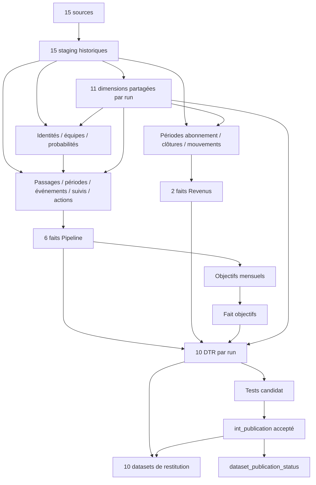

# Spécification technique — cockpit commercial et revenu

Version 0.2 — 25 octobre 2026. **Spécification finalisée pour implémentation du case ; modèles non implémentés.** Les arbitrages restants ont été tranchés par délégation explicite de l’utilisateur. Les limites de preuve ont un comportement déterministe (NULL, diagnostic et statut), et ne sont plus des questions à faire trancher par l’IA qui codera. Une fonctionnalité indiquée indisponible ne devient pas un chiffre supposé.

## 1. Autorité, sources et lecture

Ordre : [conventions](00_conventions.md), présent document, [catalogue exhaustif](02_catalogue_modeles.md), [exécution et tests](03_execution_tests.md), [journal de ce nouveau chat](ia_assistant_story.md). La demande initiale est conservée dans [le prompt](prompt_demarrage.md) et reproduite dans le journal. Les décisions de ce chat prévalent sur les propositions antérieures.

Les cinq documents métier du clean intent, correspondances, inventaire de staging et proposition d'architecture ont été lus. Les trois PNG de dashboards et leurs notes ont été inspectées visuellement, ainsi que les illustrations architecturales ; README, expression de besoin, cycle de vie, modèle JSON/JS/interface, SQL historique, configurations et DDL ont été examinés. Le README raw_intent a été consulté. Toutes les sources expressément demandées existent ; aucun AGENTS.md applicable n'a été trouvé dans les parents examinés et le dépôt. Aucun ancien journal n'est recopié dans le nouveau.

Les 38 objets de l'architecture sont des propositions : 16 intermédiaires, 9 faits, 11 dimensions, 2 liaisons. Les deux liaisons sont fusionnées avec les intermédiaires de même grain. Les blocs stg_sales/stg_subscription/stg_context des images sont des regroupements visuels, pas trois modèles. Les mentions dim_project/dim_subscription dans des diagrammes ne constituent pas deux dimensions à ajouter aux onze fiches retenues : les identités correspondantes restent dans les faits et intermédiaires.

Les annotations anciennes qui rouvrent création Boond, grain société de In demo, signature ou New MRR sont remplacées par DU-28 à DU-38. L'ancienne cascade « New MRR + Expansion » devient « New + Upsell », ou un total New MRR décomposé ; jamais total + composante. Les anciens calculs L01–L04 restent documentés comme existant, sans devenir des KPI cibles.

Chaque prescription porte l'un des sens suivants : **D** décision utilisateur ; **V** constat vérifié dans ce chat ; **F** fait documentaire ; **P** proposition technique de cette version ; **O** manque restant. Les observations du jeu fourni ne sont pas des règles métier universelles.

## 2. Décisions et constats déterminants

### 2.1 Décisions conservées et nouvelles

| ID | Statut | Règle |
|---|---|---|
| D01 | D antérieure | Entrée à création Boond, qualification distincte ; aucun formulaire retrouvé exigé comme filtre. |
| D02 | D antérieure | Signature dès entrée état 1 ; état 14 ne produit pas une seconde vente. Upsell signé = supplément vendu, activation distincte. |
| D03 | D antérieure | In demo = sociétés distinctes ; démos = RDV réellement tenus. |
| D04 | D antérieure | Boond fait référence pour MRR actif, clôture mensuelle sans prorata ; client actif = au moins une ligne en cours admissible. |
| D05 | D antérieure | Mouvements nets par société ; New total=New+Upsell ; retours dans New ; départs-retours intra-mois hors analyse détaillée ; pas de compensation entre sociétés. |
| D06 | D antérieure | MRR actif/New/churn global sans équipe ; quatre objectifs mensuels par équipe. Encaissements exclus. |
| D07 | D ce chat | Calendrier des mois et clôtures Europe/Paris ; timestamps sources conservés. |
| D08 | D ce chat | Passé corrigé par défaut, anciennes révisions conservées. |
| D09 | D ce chat | Horizons depuis chaque création individuelle ; afficher un horizon après maturité de toute la cohorte. |
| D10 | D ce chat | Durées en temps calendaire, retour=nouveau passage ; médiane et P90. |
| D11 | D ce chat | Abandonné et Non qualifié restent des issues séparées de Perdu ; Nurturing ouvert. |
| D12 | D ce chat | Ligne active : état En cours à la date observée et période admissible ; dernier jour inclus. Le montant ne décide pas l'activité : zéro connu peut rester actif. |
| D13 | D ce chat | Unité du montant opportunité non confirmée : pas de MRR signé ou comparaison monétaire officielle sans preuve de compatibilité. |
| D14 | D ce chat | Réalisé démos indisponible faute de preuve de tenue ; conserver cible, réalisé/taux NULL et motif. |
| D15 | D ce chat — réponse1.A | Accepter meta.ts comme DATE OBSERVÉE des transitions commerciales et signatures réellement constatées entre versions quand aucune date métier n'existe ; qualité CDC/proxy conservée, aucune reconstitution des lacunes. |

### 2.2 Environnement et données vérifiés

ClickHouse 25.11.9.34, serveur UTC ; Python 3.12.12 dans le venv existant, dbt-core 1.11.12 et dbt-clickhouse 1.10.1 réellement installés. Quinze tables sources MergeTree ; bases Atomic. Le projet dbt contient seulement models/.gitkeep. Les requêtes de preuve et résultats sont dans 03 ; aucun dbt debug/run/test n'a été lancé.

179 colonnes source sont présentes et correspondent au DDL/model.json. L'inventaire préparatoire en sélectionnait 159 : la convention ultérieure de reprise 1 pour 1 impose 179. Aucune collision de clé de version observée ; 14 suppressions opportunities et 55 actions sont conservées. Un seul tenant observé n'autorise pas sa suppression des clés.

L'historique peut être incomplet par objet :107 opportunités ont une création antérieure à la première publication ;106 commencent dans un état autre que Lead. Dix-sept présentent14 sans1 ni closingDate permettant de dater la signature. Toutes les actions sont liées à un contact ; parmi 607 démos60/68 courantes,151 ont zéro opportunité candidate,298 une,158 plusieurs (contrôle sans fenêtre temporelle). Aucune colonne/statut de tenue n'a été trouvée. Ni agenda passé ni candidat unique ne prouvent une réalisation ou un lien métier.

Les 326 versions de livraisons ont quantité/prix JSON et montant documenté mensuel égal à quantité×prix à0,005 près. Ne pas multiplier le montant une seconde fois par la quantité. L'état 1 est « En cours »,0 « Signée »,2 « Terminée »,3 « Annulée ». Conserver2099-12-31 comme date fournie. Des débuts ont une heure ; les fins renseignées sont à minuit, ce qui ne décide pas seul leur inclusivité (D12 la décide).

Les BU 12=LA,13=SMB et15=KAM sont observées, aucune BU ES. La présence d'une agence ou société espagnole ne vaut pas attribution d'équipe ES. Les objectifs couvrent2026, SMB/LA/ES, quatre indicateurs. Les probabilités ne distinguent pas New/Upsell et ne couvrent pas tous les anciens états. Contrôle complémentaire : Show Boond=code24 dans les dictionnaires français qui le contiennent (publications2025-03-10 et2025-12-08) ; case_rules.demo_stage_ids=[24], sans extrapolation avant sa couverture temporelle. Le code numérique ne définit pas un rang de parcours.

La mensualité et le caractère engagé du montant opportunité ne sont pas prouvés. exchangeRate=1 n'établit ni devise EUR ni mensualité ; les montants des lignes sont documentés mensuels mais leur devise reste à confirmer avant un total financier certifié ou affiché en euros.

## 3. Architecture physique et inventaire des assets

### 3.1 Bases, chemins et nommage

| Couche/module | Base ClickHouse (schema dbt) | Dossier futur sous dbt/models |
|---|---|---|
| Boond / HubSpot / références | stg_boond / stg_hubspot / stg_reference | staging/boond / staging/hubspot / staging/reference |
| Commun / Pipeline / Revenus | dwh_common / dwh_pipeline / dwh_revenue | intermediate/common / intermediate/pipeline / intermediate/revenue |
| Dimensions partagées | dtm_common | marts/common |
| Faits Pipeline / Revenus | dtm_pipeline / dtm_revenue | marts/pipeline / marts/revenue |
| DTR et datasets | dtr_sales | reporting/dtr / reporting/datasets |

Chaque modèle est un fichier <model>.sql et une entrée du YAML du dossier : _sources.yml pour sources, _models.yml pour modèles. Chaque table et chaque colonne possèdent une description. Pas de SELECT étoile, ni alias étoile ; source()/ref()/this partout dans les transformations. Les requêtes d'exploration03, distinctes des modèles, nomment les sources réellement inspectées.

P : generate_schema_name(custom_schema_name,node) retourne exactement le custom_schema_name configuré, ou target.schema uniquement pour un objet sans couche explicite ; valider les préfixes configurés à la compilation. Dans cet adaptateur, schema=base ClickHouse, sans troisième niveau database ; database omis. Les bases du case sont communes à la cible locale : pas de prétendue isolation multi-développeur. Une telle isolation demanderait une règle supplémentaire avant déploiement partagé.

### 3.2 Inventaire fermé de cette version

| Famille | Nombre | Matérialisation proposée |
|---|---:|---|
| Staging |15| Registres append CDC ou captures de changements techniques |
| Intermédiaires métier |16| Résultats historiques complets par version de calcul, append |
| Dimensions |11| Résultats historiques complets par version de calcul, append |
| Faits |9| Vues de projection explicite de leur intermédiaire canonique |
| DTR |10| Résultats historiques complets par version de calcul, append |
| Datasets métier |10| Vues explicites de la publication acceptée |
| Dataset technique de disponibilité |1| Vue dataset_publication_status, y compris familles métier vides |
| Contrôle technique int_publication |1| Table de pointeur publiée par remplacement atomique |
| **Total modèles SQL futurs** |**73**| 71 modèles métier +1 contrôle +1 vue technique |

La fusion des bridge retire deux publications redondantes. L'ajout de int_publication et de sa vue dataset_publication_status par rapport au plan initial est nécessaire pour publier un ensemble cohérent après les tests, sans faire passer les lecteurs vers un run incomplet et pour signaler une indisponibilité même si une table de détail ne contient aucune ligne. Ce ne sont ni des règles métier ni de nouveaux KPI.

Assets futurs hors modèles : macro generate_schema_name ; macros source_identity_key/source_version_key/record_key (sérialisation déterministe typée), cdc_watermark (testable et remplaçable), complete_run_rows (anti-jointure idempotente), explicit_projection et assertions de variables ; tests génériques de grain, cardinalité, périodes, disponibilité et réconciliation ; fixtures unitaires SQL typées ; dbt/config/case_rules.yml ; runner de capture/construction/publication et manifests JSON durables. Aucun de ces assets n'est implémenté par cette phase documentaire.

Les règles non fournies ne créent pas de nouvelles sources physiques. case_rules.yml est fusionné dans les vars par le futur runner : classification des états, mappings connus d'équipe, définitions de suivi, règles de disponibilité. Les options encore ouvertes restent null/non définies. Aucun seed ou source supposé n'est référencé implicitement.

### 3.3 DAG et branches



Dimensions indépendantes des faits. int_team_membership_periods utilise les dimensions et sources, jamais les faits. Les périodes/opérations commerciales et les abonnements sont branches indépendantes après les identités ; MRR ne dépend pas d'un lien prouvé à un upsell. Les objectifs dépendent des contributions commerciales publiables. Aucun lien DTR/dataset vers une préparation métier amont.

## 4. Contrats temporels, versions et disponibilité

### 4.1 Temps et calendrier

Stocker les instants en DateTime64(3,'UTC'). Les DateTime64(3) sources sont interprétés conformément au serveur UTC vérifié ; ne pas supprimer leur valeur brute en staging. Les mois se calculent sur l'instant converti Europe/Paris. Une clôture du mois M est la limite gauche du mois M+1, notée closing_boundary_at, exclusive : la photographie décrit l'instant immédiatement antérieur sans soustraire arbitrairement une seconde.

Une version publiée exactement à la borne appartient au mois suivant : choisir la dernière publication strictement antérieure à la borne. Pour un intervalle [valid_from_at,valid_to_at), le stock à clôture satisfait valid_from_at < borne et (valid_to_at est NULL ou valid_to_at >= borne). Une observation ponctuelle ordinaire t utilise valid_from_at <=t et t<valid_to_at.

D12 : start_at est un instant réel ; la date civile de fin du contrat est incluse en Europe/Paris. Préparer end_exclusive_at au début du jour suivant cette date, puis comparer des instants sans transformer la colonne dans WHERE. Une fin absente est ouverte ;2099 reste2099. Une ligne terminée/annulée dans la version pertinente n'est pas active par simple présence d'un ancien début. Sélectionner la version pertinente avant d'appliquer état/suppression/bornes. Ne pas utiliser le dernier état 2026 pour mesurer une clôture 2024.

P : durée physique = (sortie_UTC_ms − entrée_UTC_ms)/1000 secondes ; présentation en jours continus = secondes/86400, sans troncature ni exclusion des week-ends. Un changement d'heure peut produire23/25 h entre mêmes heures locales. Les horizons J+H ajoutent H jours calendaires au timestamp de création en Europe/Paris, puis reconvertissent en UTC ; ne pas remplacer par H×86400 secondes. Ces précisions de calcul sont des propositions techniques explicites sous D09/D10.

P : maturité de la cohorte = maximum des horizon_at des membres connus, par tenant/mois/type commercial/définition/horizon, calculé avant filtres équipe/canal. Le type définit un parcours/cohorte distinct. Une cohorte dont tous les membres ont atteint l'âge peut néanmoins être non observable ; la couverture source est un contrôle séparé. Horizon non atteint : taux NULL, statut non_mature. Garder les autres issues/inconnus dans le dénominateur complet et publier les effectifs de couverture.

### 4.2 Histoire source, histoire métier et révisions

meta.ts ordonne les observations CDC, sans certifier toute date métier. Contrôle complémentaire Q12 :194/214 lignes ont une création postérieure à une publication CDC, malgré une création constante par ligne et aucun début de service antérieur à cette création. La cause n'est pas établie. Une telle création ne prouve pas l'absence de la ligne avant sa date ; garder le défaut de chronologie et les périodes observées. Pour les autres cas cohérents, une naissance prouvée peut donner activité false/contribution 0 avant naissance, sans faire apparaître les lignes futures comme contributions inconnues de tous les mois passés. Conserver date métier, publication, import et calcul séparément. «Passé corrigé» signifie recomposer avec les entrées/règles corrigées applicables à leur date : arrivée CDC tardive, lien ou date d'effet prouvés. Cela n'autorise pas à appliquer rétroactivement toute dernière version publiée après une clôture. Sans date d'effet prouvée, signaler correction indéterminée et G04/G05, plutôt que déplacer arbitrairement un changement vers le passé. Un premier état avancé ne prouve ni entrée à création ni absence des étapes précédentes : entered_at peut être NULL, first_observed_at reste renseigné. Une signature état 14 sans passage1 n'acquiert pas une date fictive. Les transitions vers1 réellement observées entre versions peuvent utiliser meta.ts comme date observée selon D15 ; event_time_basis=cdc_transition_proxy et is_event_time_accepted=true. Ce choix autorise leur utilisation dans les flux du case sous les autres règles d'éligibilité/couverture, sans certifier une date métier exacte.

P : v1 utilise des recompositions logiques complètes à petit volume, conservées dans 27 tables dim/int et 10 DTR, plutôt qu'un mécanisme universel de corrections ligne par ligne. Un model_run_id identifie l'empreinte des entrées figées, captures complètes, code, règles et paramètres de calcul. Les mêmes entrées produisent le même identifiant et aucun nouveau stockage. Tout changement produit un nouveau run complet ; les anciens restent consultables. Les 9 faits exposent l'histoire de leur intermédiaire sans la recalculer avec les référentiels courants.

Grain physique dérivé = (model_run_id,record_key) ; record_version_key=hash de ce tuple. Les clés de version de dimensions sont stables pour une version métier ; TOUTE jointure entre dérivés inclut aussi model_run_id. Les lignes qui disparaissent d'une recomposition ne sont pas courantes dans le nouveau run ; elles restent dans l'ancien. Aucun écrasement ni tombstone dérivé n'est nécessaire avec ce contrat de snapshot complet.

Chaque table dérivée porte model_run_id,record_key,record_version_key,row_hash,calculated_at,rule_version,input_cutoff_at. Les colonnes de période n'existent que pour les modèles représentant des intervalles. Append ne garantit pas l'absence de doublons : l'anti-jointure sur run+record_key et les tests sont obligatoires, ainsi que la sérialisation des écritures par cible. Une ligne présente ne signifie jamais que le run est complet : manifest de succès, nombre de clés et digest attendus avant publication.

Les vues de faits et de datasets n'effacent aucune révision persistée. Les vues de faits exposent tous les runs ; les datasets sélectionnent le seul int_publication courant. Une lecture ancienne explicite interroge les DTR avec son model_run_id ; pas de modification du pointeur pour une simple analyse.

### 4.2 ter Admission des dates observées — décision D15

Lorsque deux versions successives admissibles d'un objet révèlent un changement d'étape, utiliser la publication meta.ts de la première version du nouvel état comme date OBSERVÉE si aucune date métier prouvée n'existe. Une modification de montant ou responsable sans changement d'état ne crée pas de transition. Pour la création, conserver creationDate ; ne pas lui substituer meta.ts.

D15 s'applique aux passages terminés/en cours, événements, signatures observées, cycles, conversions et lectures de cohortes fondés sur ces bornes observées. is_event_time_accepted=true pour business_created/business_proven et cdc_transition_proxy admissible ; conserver event_time_basis et la provenance source. Les autres conditions de population, couverture, montant, devise et re-signature restent indépendantes.

Une première observation déjà avancée ne prouve pas la date d'entrée dans cet état : bornes antérieures inconnues, left_censored/observation_only distincts d'une transition constatée. L'état14 sans passage1 ne devient pas une signature datée. Une suppression ou lacune ne se transforme pas en passage continu connu. Aucune correction rétroactive d'effet métier n'est déduite de cette acceptation.

### 4.2 bis Sérialisation déterministe H et empreinte du run

P : H est défini, pas laissé à une concaténation ambiguë. UTF-8, SHA256 puis hexadécimal minuscule. Préimage : JSON d'un tuple ordonné commençant par le domaine/version de clé (ex. source_version_v1,company_v1,visit_v1), suivi pour chaque composant du tuple (nom, type déclaré, marqueur NULL sous forme de chaîne 0/1, valeur canonique sous forme de chaîne). Tout élément JSON est une chaîne, y compris le marqueur : les réglages ClickHouse de citation des entiers64 ne changent donc pas la préimage. Une valeur NULL a une chaîne valeur vide et marqueur1 ; une chaîne vide a marqueur0. Les séparateurs et l'échappement sont produits par toJSONString, jamais concaténation de valeurs avec séparateur artisanal.

Valeur canonique : String/JSON source exactement conservé (pas trim ni reformatage JSON pour l'empreinte source), entier en décimal sans séparateur, Bool en0/1, Date en YYYY-MM-DD, timestamp UTC en entier de millisecondes epoch, Decimal en texte à l'échelle déclarée, Float64 par toString avec version serveur/version de sérialisation figées ; rejeter NaN/Inf avant publication. L'ordre des colonnes sources est exactement celui des fiches staging. Le domaine de toute identité source inclut le nom logique qualifié de sa source (boond.opportunities,boond.actions,hubspot.contacts,case_reference.sales_targets, etc.) : deux tables ne partagent jamais une identité source parce que leurs id numériques sont égaux. source_version_key réutilise cette identité qualifiée. Les clés de grain suivent exactement l'ordre de la fiche ; une modification de contrat change le domaine/version et exige migration, pas remplacement silencieux.

Les empreintes d'un ensemble de clés utilisent la liste triée des clés uniques, avec comptage et SHA256 du JSON de cette liste ; pas une somme de hashes présentée comme preuve sans collision. Ce choix est adapté au petit jeu fourni, sans garantie de performance à gros volume. Le run utilise les empreintes des versions d'entrée ADMISES, code et paramètres sémantiques (règles, période/calendrier de calcul, couverture déclarée). Exclure les identifiants de tentative, calculated_at, durées d'exécution et captures vides sans changement ; leur modification seule ne crée pas de nouveau run. Une couverture déclarée différente peut, elle, changer les résultats d'observabilité et donc l'empreinte.

Si l'empreinte existe déjà, le runner réutilise calculated_at,input_cutoff_at,rule_version et toutes les métadonnées figées de la première tentative avant de calculer ou compléter les lignes. Un run complet est réutilisé sans copie ; un run partiel est repris avec ses mêmes métadonnées. Un cutoff qui change le jeu admis ou l'observabilité change l'empreinte ; une simple date de tentative ne réécrit pas le cutoff du run ancien.

Avant de compléter un run partiel, vérifier que les lignes déjà écrites sous son identité ont le même row_hash que la recomposition ; un contenu divergent sous même run/record_key bloque la reprise. Ne pas masquer cette divergence par l'anti-jointure.

### 4.3 Montants, ratios et disponibilité

Sources Float conservées en staging. Montants canoniques Decimal(38,4) via conversion par représentation chaîne, préservant NULL. Calculs sans arrondis intermédiaires ; arrondi d'affichage à2 décimales avec round sur Decimal (demi loin de zéro, vérifié +1,005→1,01 et−1,005→−1,01). Probabilités validées : Decimal(18,8) ; calculer les produits à précision intermédiaire explicite avant conversion finale, sans laisser ClickHouse choisir silencieusement une perte d'échelle. Pour un montant 38,4 × probabilité18,8, conserver le produit en Decimal(38,12) pendant la somme ; la conversion38,4 n'est admise qu'après contrôle d'égalité exacte avec le produit/somme intermédiaire. Une perte exige migration d'échelle des colonnes pondérées avant publication, jamais troncature silencieuse ni somme d'arrondis locaux. Ratios Nullable(Float64), numérateur/dénominateur conservés.

Le montant mensuel d'une livraison est pris UNE fois ; quantité×prix sert de rapprochement. Une somme comportant une contribution requise inconnue n'est pas certifiée : publier nb_expected/nb_known et NULL pour le total officiel, éventuellement un montant partiel clairement nommé. Devise inconnue : source_amount conservé ; hors hypothèse de case, pas de label EUR ni total entre devises non validées ; pour ce jeu, D20 impose explicitement EUR sans conversion de change. EUR pour les objectifs est documentaire ; cela ne prouve pas l'unité du réalisé.

availability_status prend available,partial,blocked_definition,blocked_evidence,non_mature,not_observable,not_applicable. availability_reason contient un code stable. Le registre de base comprend : missing_demo_completion_proof,unconfirmed_amount_unit,unconfirmed_currency,missing_target_scope,missing_probability_rule,missing_team_mapping,missing_channel_rule,missing_duration_team_rule,missing_threshold,unknown_event_date,incomplete_history,source_coverage_unconfirmed. Les fiches core utilisent calculation_status=ready/partial/blocked/not_applicable et status_reason. La normalisation vers le contrôle public est explicite : ready→available seulement si couverture/admissibilité satisfaites ; partial→partial ; blocked→blocked_definition pour règle manquante ou blocked_evidence pour preuve manquante ; not_applicable inchangé. Les drapeaux d'horizon et de couverture prennent priorité pour non_mature/not_observable. Normaliser currency_unconfirmed→unconfirmed_currency et missing_mrr_unit/unconfirmed_amount_unit→unconfirmed_amount_unit ; les causes plus fines des fiches restent documentées dans status_reason et sont conservées dans le manifest. Les datasets métier peuvent conserver ce vocabulaire interne ; dataset_publication_status expose le domaine public. Une seule mesure peut avoir plusieurs obstacles : conserver leur liste dans le manifest et exposer la raison prioritaire (non_mature,non_observable,preuve,règle,partial) sans masquer les autres.

Un statut peut être spécifique à une mesure : une ligne reste utile pour son volume alors que son montant est indisponible. Les champs précis du catalogue priment sur un statut global trop grossier.

## 5. Capture, incrémental et publication

### 5.1 Protocole CDC

Premier chargement complet ; cible vide=>complet. Ensuite maxOrNull(src_published_at) lu une fois, moins cdc_overlap_hours. P : défaut technique48 h, pas une garantie mesurée ni une décision utilisateur historique. Comparaison src_published_at >= borne typée. Aucun filtre hier ni exigence de coïncidence updateDate/meta.ts.

source_payload_hash est l'empreinte du tuple ORDONNÉ de toutes les colonnes sources, sérialisées avec leur type et distinction NULL/chaîne vide. source_version_key=hash(identité source,publication,payload_hash). L'identité inclut tenant/id, ou tenant/langue pour dictionnaires. Préserver deux contenus d'un même timestamp avec leurs empreintes ; test conflit sur (identité,publication) bloque les traitements métier concernés, sans ordre arbitraire entre contenus. Répétitions identiques regroupées, puis anti-jointure vers this. imported_at n'entre pas dans payload_hash.

Conserver la borne tentée et le capture_key avant lancement. Après échec rejouer la même borne ; si inconnue, cdc_full_scan=true avec anti-jointure. Le maximum cible peut avoir avancé lors d'un échec partiel. Avant chaque publication mensuelle, contrôler exhaustivement les clés source absentes et rattraper ; sur le case statique, ce contrôle complet est également requis pour toute publication candidate. Ne jamais utiliser full-refresh pour effacer les versions capturées. Une évolution de schéma déclenche on_schema_change=fail et une migration documentée. Configurer unique_key='source_version_key' pour staging et unique_key='record_version_key' pour tables dérivées, sans inserts_only=true : le code1.10.1 court-circuite sinon la vérification de schéma dans sa branche INSERT directe. Ces unique_key ne dédupliquent pas append ; les anti-jointures restent obligatoires. Le runner compare aussi les empreintes de schéma avant capture.

### 5.2 Captures HubSpot et ref

Chaque capture lit entièrement l'état source, compare au dernier état d'une capture complète et insère seulement changements/retours et absences observées. Une réversion A→B→A est une nouvelle version : sa clé inclut capture_key/capture_at et présence, pas seulement identité+hash. Conserver archived,updatedAt et les valeurs brutes. Une disparition physique donne is_source_present=false, pas un churn ni une suppression métier inventée ; conserver les dernières valeurs comme preuve technique.

capture_key identifie une source et un instant figé de capture. Les captures échouées ne sont pas utilisables : source_capture_keys passé dans les vars énumère les captures complètes autorisées pour les 4 sources. Si la source a changé pendant la reprise d'une capture nonCDC, abandonner cette tentative et créer un nouveau capture_key ; ses anciennes lignes physiques restent non publiées. Une table vide ne prouve pas une disparition générale : exiger fin de lecture réussie et validation explicite de la baisse anormale avant de marquer complète la capture. Pas de suppression physique d'un historique par un full-refresh.

P : succès, comptages, empreintes et bornes sont conservés dans des manifests JSON durables par le futur runner. Ces fichiers sont des métadonnées d'exécution, pas de nouvelles tables sources. L'historique obtenu commence à nos observations ; il ne prouve pas le passé avant capture. Les snapshots natifs ne sont pas retenus par défaut compte tenu des limites de l'adaptateur1.10.1 relevées dans 03.

### 5.3 Manifests et paramètres du runner futur

La capture s'exécute source par source avec ses capture_key/capture_at et son JSON de capture ; seules les captures réussies alimentent ensuite un NOUVEAU JSON de calcul figé (source_capture_keys,empreintes,cutoff,run). La publication reçoit un troisième JSON validé après tests. Ne pas réutiliser un JSON de calcul préparé avant les succès de capture.

Le runner reste à implémenter ; aucune commande le supposant déjà présent n'est exécutée. Son interface doit accepter un fichier JSON de paramètres, produire le fichier vars dbt et un manifest, exécuter les commandes 03 puis enregistrer le résultat. Le manifest contient : execution_key,phase,status,start/end UTC,source/table,capture_key,capture_at,borne_basse/haute,schéma source hash,nb_rows lus/écrits,nb_keys/digest attendus et chargés,source_capture_keys complets,input_cutoff_at,model_run_id,rule_version,code_hash,vars_hash,commandes/exit_codes,tests,ancienne/nouvelle publication. Écrire les bornes AVANT toute insertion ; ne marquer success qu'après les contrôles. Écriture locale du manifest atomique et conservation de la tentative échouée.

| Variable | Type / valeur de première version |
|---|---|
| cdc_overlap_hours | entier>=0 ;48 par défaut technique |
| cdc_replay_from_at | instant UTC ms ou null ; borne imposée du retry |
| cdc_full_scan | booléen false ; true pour réconciliation/rattrapage |
| capture_key / capture_at | identifiant par source / instant UTC ms figé |
| source_capture_keys | dictionnaire des 4 sources nonCDC vers listes de captures complètes |
| source_tenant_id | demo_crm pour rattachement explicite de HubSpot/ref dans int/dim ; absent du staging source |
| publication_quality_json | tableau JSON validé de statuts par mesure/famille ; [] au bootstrap |
| model_run_id | SHA256 hex minuscule des entrées/code/règles/params figés ; requis pour dérivés |
| calculated_at / input_cutoff_at | instants UTC ms figés ; calcul distinct de couverture métier |
| rule_version | empreinte des règles/code/version de catalogue |
| test_model_run_id | run candidat pour tests, indépendant de la publication |
| publication_model_run_id / publication_at | null seulement au bootstrap initial, puis run accepté et instant UTC ms |
| business_timezone | Europe/Paris, verrouillé pour cette version |
| event_time_policy | observed_cdc_allowed, décision D15 ; paramètre sémantique inclus dans rule_version/empreinte du run |
| data_coverage_end_at | borne déclarée et justifiée par source ; null si non confirmée |
| currency_code / channel_rule / probability_rule / target_scopes | décisions D20–D24 et paramètres §7 ; preuve commerciale mensuelle et tenue de démo restent absentes |
| stagnation_thresholds / duration_team_rule | seuil21jours strict, paramétrable ; équipe à entrée du passage, décisions D25/D26 |

Les filtres BI d'observation et de période ne sont pas des fragments SQL injectés dans des vues. Ils sont typés/validés par le consommateur, bornés par la couverture déclarée ; les datasets conservent le détail nécessaire. Le snapshot documentaire2026-09-30 ne prouve pas à lui seul une exhaustivité ; D16 en fait une hypothèse de case déclarée, avec borne Paris et lacunes conservées. max(updateDate), parfois futur, ne définit ni fraîcheur ni observation.

### 5.4 int_publication : fiche technique

Fichier futur intermediate/common/int_publication.sql, base dwh_common, tag publication seul ; table MergeTree ORDER BY tuple(). Grain : une ligne de publication courante, aucune au bootstrap. Colonnes : model_run_id String, publication_key String=hash(run,publication_at),published_at DateTime64(3,'UTC'),input_cutoff_at DateTime64(3,'UTC'),rule_version String,quality_json String (tableau JSON de statuts validés par mesure/famille). Aucune dépendance ref vers DTR pour éviter qu'une sélection avec descendants publie automatiquement.

Une requête SELECT de constantes typées alimentée par vars suffit ; en bootstrap initial, SELECT typé filtré par0 produit la table vide. Le runner refuse publication_model_run_id=null si un pointeur existe déjà. En publication, le runner vérifie le manifest candidat complet et tous tests requis avant le dbt run isolé. Le remplacement dbt s'appuie sur table Atomic/EXCHANGE vérifié statiquement ; aucun DDL manuel dans le modèle. Ce pointeur rend la bascule des datasets cohérente pour une requête, pas tout le DAG transactionnel ni plusieurs requêtes BI démarrées de part et d'autre de la bascule.

dataset_publication_status expose le run accepté et les statuts par mesure/famille, avec nb_expected/nb_known et couverture nullable ; toute mesure attendue doit avoir une entrée, même sans ligne métier. Le champ quality_json provient du résumé des contrôles du candidat, pas d'une valeur saisie arbitrairement pour débloquer un KPI. Une page lit ce dataset avant ses agrégats ; une famille vide sans preuve ne devient pas un zéro.

Bootstrap avant création initiale des vues datasets ; ensuite construire/tests candidats, créer/valider les vues, et publier en dernière étape. Faits/DTR conservent les anciens runs, donc changer le pointeur ne supprime pas le passé. Revenir à un run ancien accepté permet un rollback de publication sans effacer de données. Les migrations de schéma des vues restent un déploiement séparé à compatibilité vérifiée.

## 6. Couverture KPI, dashboards et filtres

| Besoin / catalogue | Sources → modèles canoniques → restitution | État |
|---|---|---|
| M02,U01 : génération, entrées/sorties | opportunities+dictionaries → events/periods → fct_opportunity_event → sales_events | Volumes observables D15/D22 ; valeur à entrée seulement si connue, unité non confirmée D13 |
| M03/M04/M05,B03 : ouvert, valeur, pondéré et histoire | opportunities+BU+probabilités → periods/probabilities → fct_opportunity_period → pipeline_periods | Volume selon D30 ; barème D21 ; unité commerciale non confirmée D13 |
| M01/O01–O04 : quatre objectifs | sales_targets + contributions Pipeline → objectives_month → sales_objectives_month | Cibles disponibles ; réalisés compatibles conditionnels, démos NULL |
| U01/B02 : tunnel et cohortes | création+versions états → followup → fct_opportunity_followup → funnel_progress/cohort_outcomes | Cohortes, conversions et réouvertures définies D17–D19 ; observabilité conservée |
| B01/M08/U03 : passages, durées, stagnation | opportunities+versions → stage_visits/responsibility → fct_stage_visit → stage_visits | Durées observées D15 ; équipe à entrée D25 et seuil paramétrable D26 |
| U04-S/O04 : RDV réalisés | actions+contacts → actions_prepared → fct_action → sales_actions | Bloqué preuve de tenue ; pas de proxy silencieux |
| U04-P : In demo | periods+company → fct_opportunity_period → pipeline_periods | Distinct société recalculé, pas somme des équipes |
| U03 : micro-funnel démo | actions+liens vérifiés → demo_intervals → fct_demo_interval → demo_intervals | Chaînage non prouvé, délais officiels indisponibles |
| U02/U06 : signatures/cycle/MRR signé | events → fct_opportunity_event → sales_events et objectifs | État1 reconnu ; date et montant officiels conditionnels |
| U05/U07/U10–U13 : MRR et clientèle | deliveries+projects+companies → subscription_periods/month_end/client_context/mrr_movements →2 faits → company_mrr_month | Formules et hypothèses de case D16/D20 ; première acquisition conservatrice D27 |
| Navigation dossier | périodes+passages+événements → opportunity_timeline | Union typée sans sommer grains incompatibles |
| U14 : individu/équipe | responsabilités/actions/événements + membership | Détail conservé ; comparateur non activé D28, aucune cible personnelle |
| M06/M07/BP,U09 | couverture/potentiel/scénario | Attentes conservées, fonctionnalités non activées D28 ; aucune formule inventée |
| U08,H01–H10,L01–L04 | paiements/hypothèses/existant | U08 exclu ; H seulement si repris explicitement ; L explicatifs, pas cibles |

Les fiches DTR du catalogue associent chacun des blocs/cartes/tableaux/filtres des trois maquettes. Le mois et l'équipe de synthèse filtrent les objectifs ; cohorte/type/mesure sont locaux au tunnel. Le portefeuille ignore l'équipe et le type commercial ; le filtre financier New/Upsell sélectionne des contributions de croissance sans retirer départs/baisses ni casser la cascade complète.

Durées : période d'entrée et date d'observation distinctes. Sortie après observation=>en cours, sans exposer sa durée finale à cette observation. Pas de mélange durées terminées/anciennetés ni moyenne de médianes. Conserver les passages à début inconnu dans le compteur de couverture ; durée NULL.

Cohortes : opportunités, jamais sociétés ni RDV ; une ligne par opportunité/définition/ancrage/horizon et run. Les horizons30/60/90 ne s'additionnent pas. Le dénominateur complet inclut autres issues et inconnus ; maturité et couverture séparées. La maquette doit donc prévoir les compléments d'issues/couverture absents des exemples fictifs.

## 7. Arbitrages finalisés sous délégation — version0.2

L’utilisateur a explicitement demandé de trancher toutes les questions restantes, de mettre à jour les documents puis de fournir un prompt d’implémentation. Les choix D16–D30 ci-dessous sont des **décisions de case prises par l’assistant sous cette délégation**, et non des faits vérifiés dans les données. D01–D15 restent acquis, notamment montants commerciaux non confirmés, démos réalisées sans preuve indisponibles, dates CDC observées admises et historique conservé. Aucune validation individuelle fictive des recommandations n’est attribuée à l’utilisateur.

| Décision | Choix normatif et effets |
|---|---|
| D16 — Couverture | Hypothèse de case : extrait complet jusqu’à la clôture du30septembre2026 en Europe/Paris, borne exclusive2026-10-01T00:00:00+02:00 =2026-09-30T22:00:00Z. Ni dernière modification ni maximum CDC ne prouvent cette exhaustivité. Chaque objet reste observable seulement depuis sa première trace et dans ses intervalles sans lacune connue. Conserver les débuts censurés, suppressions et194 chronologies de création incohérentes. HubSpot/ref capturés maintenant ne reconstituent aucun état ancien. |
| D17 — Tunnel | Cohorte de création Boond, un dossier par identité. Nouvelles ventes : Création→Qualification22→Découverte23→Démo24→Proposition21→Closing28→Signé1. Upsells : Création→Proposition21→Closing28→Signé1. Création est un ancrage, pas un état0 inventé. Les étapes25/26 et tous détails restent dans le parcours. Compter chaque étape réellement atteinte une seule fois par opportunité et définition ; ne pas inférer une étape sautée ni forcer un rétrécissement monotone. Modes activés : opportunités et taux ; montants et durées du tunnel sont explicitement non activés. |
| D18 — Réouvertures | Une seule première signature observée admissible par opportunité ; les signatures ultérieures restent traces avec contribution de nouvelle vente0, sans effacer la première. Une preuve de gain1/14 déjà présente avant la première transition datable interdit de compter une re-signature comme nouvelle vente : la signature ancienne reste non datable, jamais déplacée à la réouverture. Aucun retour ne change la cohorte de création. Cohorte à J : état effectivement observé au J considéré, donc un gagné rouvert peut être ouvert à un horizon ultérieur. Conversion A→B : première entrée A observable par dossier, puis première B après cette A et avant observation ; pas de multiplication par les retours. La conversion globale est «a atteint une signature», distincte de l’état à horizon. |
| D19 — Cycle | Création→première issue terminale OBSERVÉE et datable (gagné/perdu/abandonné/nonqualifié), une contribution par opportunité. Libellé «temps jusqu’à la première issue observée». Une première issue censurée ne reçoit aucune durée ; conserver événements et épisodes ultérieurs sans les mélanger à ce KPI. |
| D20 — Devise | Hypothèse explicite de case EUR pour les montants Boond et les cibles ; aucun calcul de change inventé. Cette décision rend les sommes mensuelles d’abonnements financièrement comparables, sous réserve de couverture et qualité des lignes. Elle ne prouve PAS que le montant estimé d’une opportunité est mensuel ou signé : D13 reste applicable, MRR signé et comparaisons monétaires non compatibles restent NULL. |
| D21 — Coefficients | Utiliser exclusivement ref.stage_probabilities, état×segment, pour types4 et7. Recalculer l’histoire observée avec le dernier barème capturé accepté du run, explicitement nommé «historique recalculé au barème fourni». Ne pas présenter ce barème comme connu à l’époque ; conserver ses captures et la règle de calcul. Coefficient absent, segment inconnu ou ancien état non couvert : NULL, aucun fallback weighting Boond et jamais0. Les champs Boond restent diagnostiques. |
| D22 — Objectifs | Les quatre objectifs couvrent types commerciaux4(nouvelle vente)+7(upsell), formation2 exclue ; autres types conservés dans l’histoire, hors comparaisons commerciales. Généré et signé sont flux du mois ; pondéré est stock de clôture ; démos sont RDV tenus du mois. Faute de preuve de montant/unité ou tenue, conserver cible et réalisé/taux NULL. Aucun objectif personnel. |
| D23 — Équipes | BU12→LA,13→SMB ;15 reste KAM, équipe connue sans cible fournie, jamais reclassée ES. Utiliser l’appartenance historique, sans rétropolation de l’équipe actuelle. Plusieurs appartenances ou responsable absent : attribution inconnue, sans double contribution. ES reste un segment de cible sans équipe résolue : cible conservée, réalisé et taux NULL, pas0. KAM peut être filtrée dans les faits ; son sales_segment de cible reste NULL. Un global d’objectifs contenant un segment non calculable reste incomplet/NULL, avec détail de couverture. |
| D24 — Acquisition | Canal=origin.typeOf de l’opportunité à création, figé seulement si cette valeur est observable à l’entrée ; sinon inconnu, pas premier montant/source ultérieur ni substitution contact/HubSpot. Inbound : codes1 Formulaire site,2 LinkedIn Ads,3 Webinar ; Outbound :4 Prospection téléphonique,5 LinkedIn Sales ;6–11 restent Autres avec leur détail, pas Outbound automatique. Source/codes sont vérifiés, regroupement et priorité sont des choix de case. |
| D25 — Équipe des durées | Filtre équipe sur l’équipe à l’entrée du passage, pour terminés et en cours. Le transfert ne redémarre pas le passage et ne répartit pas sa durée complète entre équipes. Équipe d’entrée inconnue : durée globale conservée, catégorie nonattribuée visible ; aucune attribution rétrospective par équipe actuelle. Les tranches de responsabilité restent consultables, sans dupliquer les quantiles de passages. |
| D26 — Alertes et classes | Seuil par défaut21 jours continus, strictement ancienneté>21, paramétrable par étape/type et en restitution. Classes par défaut[0,7),[7,14),[14,30),[30,+inf), sans trous ni arrondis avant classement. Seuil nul/absent explicitement désactivé : aucune alerte à défaut. Le21 est un choix de case, pas un seuil métier empiriquement validé. |
| D27 — Nouveaux clients | Retours exclus du compteur de première acquisition ; ils restent entrants entre clôtures et inclus dans New MRR monétaire, conformément aux décisions antérieures. Première acquisition comptable seulement si première activation prouvée et couverture antérieure suffisante ; sinon first_acquisition_status=unknown, aucun nouveau client inventé à la première observation. Conserver séparément la première activation observée et les retours prouvés. |
| D28 — Fonctionnalités sans preuve/formule | Implémenter les73 contrats et les statuts. Réalisé démos, MRR signé, chaînage démo non prouvé : NULL et raisons explicites. M06 couverture, M07 potentiel moyen/BP, scénario U09 et comparateur individuel U14 : attentes documentées et contributions conservées, calcul officiel non activé dans ce périmètre. Aucun dénominateur O01 arbitraire, aucune projection ni moyenne d’équipe inventée. Ce sont des fonctionnalités non activées, pas des questions laissées à l’implémenteur. |
| D29 — Exploitation/rétention | Exécution manuelle à la demande, pas de service ou cadence automatique à installer. Réconciliation complète avant publication du case, fraîcheur décrite par capture/publication et borne de case ; aucune promesse temps réel. Préserver au moins5ans d’agrégats quand disponibles ; aucune purge/TTL automatique des détails, captures ou révisions dans ce case. Ne pas déduire une politique de production ou une conformité juridique. |
| D30 — États anciens | Classification de case : ouverts0,20–26,28,30–35 ; gagnés1/14 ; perdus13/27 ; abandonnés3/9 ; nonqualifiés2/7 ;10/19 et codes non mappés restent unknown/unclassified, dans le dénominateur et la couverture. Aucun état ancien n’est assimilé à une étape moderne absente : «En cours chaud» ne prouve pas une Qualification ou une Démo. Mapping temporel des libellés conservé, isEnabled n’est pas une activité commerciale. |

### 7.1 Traduction exécutable des paramètres

Le futur dbt/config/case_rules.yml reprend les valeurs suivantes, fusionnées par le runner dans les vars. Aucun fichier de règles dbt n’est créé dans cette phase documentaire. Les hash de règles incluent ces décisions ; les anciennes révisions v0.1 restent reproductibles avec leur ancien rule_version.

```yaml
business_timezone: Europe/Paris
source_tenant_id: demo_crm
event_time_policy: observed_cdc_allowed
case_as_of_boundary_at: '2026-09-30T22:00:00.000Z'
coverage_policy: case_snapshot_assumed_complete_after_first_observation
currency_code: EUR
currency_basis: delegated_case_assumption
commercial_sale_types:
- 4
- 7
excluded_target_sale_types:
- 2
target_sale_types:
  mrr_signed:
  - 4
  - 7
  pipeline_generated:
  - 4
  - 7
  pipeline_weighted:
  - 4
  - 7
  demos:
  - 4
  - 7
probability_source: ref.stage_probabilities
probability_sale_types:
- 4
- 7
probability_history_policy: recomputed_with_latest_captured_schedule
probability_missing_policy: null_no_fallback
team_sales_segments:
  '12': LA
  '13': SMB
known_non_target_team_ids:
- 15
unresolved_target_segments:
- ES
channel_source: opportunity_origin_at_creation
channel_fallback: none
inbound_origin_ids:
- 1
- 2
- 3
outbound_origin_ids:
- 4
- 5
demo_stage_ids:
- 24
funnel_paths:
  '4':
  - 0
  - 22
  - 23
  - 24
  - 21
  - 28
  - 1
  '7':
  - 0
  - 21
  - 28
  - 1
funnel_zero_stage_role: creation_anchor_not_inferred_state_0
funnel_modes:
- opportunities
- transition_rates
funnel_reach_policy: observed_only_once_per_opportunity
transition_anchor_policy: first_observable_entry_A_then_first_B_after_A
signatures_policy: first_observed_signature_once_per_opportunity
cohort_outcome_policy: state_at_individual_horizon
cycle_policy: creation_to_first_datable_observed_terminal_issue
duration_team_rule: team_at_visit_entry
default_stagnation_threshold_days: 21
stagnation_comparison: strictly_greater_than
duration_bins_days:
- 0
- 7
- 14
- 30
duration_last_bin_unbounded: true
first_acquisition_policy: first_proven_activation_only_returns_separate
refresh_mode: manual
automatic_purge: false
aggregate_retention_years_minimum: 5
unsupported_measures:
- signed_mrr_without_monthly_proof
- realized_demos_without_completion_proof
- unproven_demo_intervals
- pipeline_coverage
- potential_mrr_mean
- bp_activity_estimate
- constant_portfolio_scenario
- individual_team_comparator
outcome_stage_ids:
  open:
  - 0
  - 20
  - 21
  - 22
  - 23
  - 24
  - 25
  - 26
  - 28
  - 30
  - 31
  - 32
  - 33
  - 34
  - 35
  won:
  - 1
  - 14
  lost:
  - 13
  - 27
  abandoned:
  - 3
  - 9
  unqualified:
  - 2
  - 7
  unknown:
  - 10
  - 19
```

case_history_start_at est calculé par le runner comme minimum des publications CDC d’opportunités admises puis figé au manifest ; il borne le RECALCUL des coefficients, pas une couverture antérieure inventée.

case_as_of_boundary_at est une borne métier de case ; input_cutoff_at et capture_at restent les véritables instants techniques d’import, éventuellement postérieurs. On peut capturer aujourd’hui l’état fourni comme extrait de fin septembre par hypothèse, mais cela ne donne ni versions passées HubSpot/ref ni anciennes probabilités : leur utilisation rétrospective est uniquement la règle de recalcul D21, explicitement tracée.

### 7.2 Clôture des anciens G01–G10

| Ancien point | État final pour implémentation |
|---|---|
| G01 | Valeur à création conservée quand observable, aucun rattrapage par valeur ultérieure. Mensualité/supplément signé sans preuve : indisponibilité D13/D28, pas d’arbitrage en attente. |
| G02 | Tranché par D21 ; absence de coefficient reste une donnée manquante. |
| G03 | Tranché par D24 ; origine à création manquante reste inconnue. |
| G04 | D15/D17/D18/D19 : dates, parcours, comptages, réouvertures et cycle définis. |
| G05 | D16/D20 : hypothèses de case explicites ; lacunes et anomalies factuelles conservées, jamais certifiées résolues par hypothèse. |
| G06/G07 | D22/D23 : périmètres et équipes définis ; ES et ambiguïtés restent nonattribués. |
| G08 | D25/D26 : attribution, seuils et classes définis. |
| G09 | D14/D28 : preuve absente et chaînage non démontré, sorties indisponibles avec schémas/tests obligatoires. |
| G10 | D27/D28/D29 : compteur, exploitation/rétention et périmètre non activé explicités. |

Aucun de ces points n’est à faire arbitrer par l’IA qui implémentera. Une impossibilité technique constatée doit être documentée et corrigée dans le cadre de ces règles ; une nouvelle preuve ne permet pas de réinterpréter silencieusement D13/D14 ou de réécrire une source.

## 8. Acceptation de la spécification

La revue documentaire vérifie73 fiches,179 colonnes source, chaque héritage explicitement énuméré, nom/type/nullabilité/origine de chaque sortie, DAG sans cycle, mêmes clés et dates entre modèles, branche de reprise par modèle, règles de jointure sans fan-out, chaque bloc3 dashboards et chaque ID de catalogue reliés. Vérifier l'absence de SELECT étoile et de noms physiques codés en dur dans les exemples de modèles.

Les tests/commandes 03 sont un plan exécutable après implémentation, pas des résultats prétendument obtenus. Le support unitaire et les stratégies sont vérifiés statiquement dans l'adaptateur installé ; seuls les SELECT de contrôle ont été exécutés. Aucune performance cible n'est garantie sans mesure. La spécification v0.2 est prête à implémenter avec les décisions §7 et les indisponibilités intentionnelles décrites. L’acceptation porte sur73 contrats, règles applicables, NULL/qualité lorsque requis, reprise et tests ; elle ne signifie pas que toutes les mesures souhaitées sont prouvées dans les données. Aucun résultat de test dbt n’est acquis avant son exécution.
